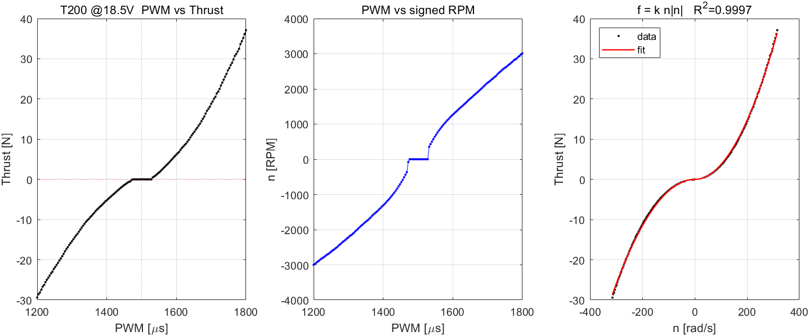
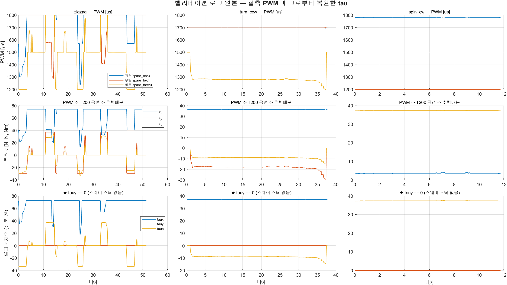
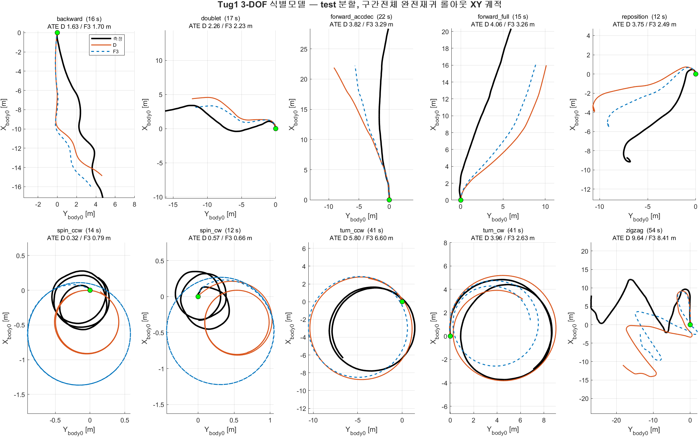
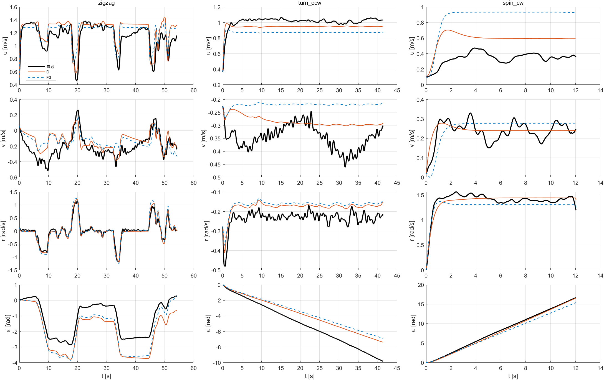
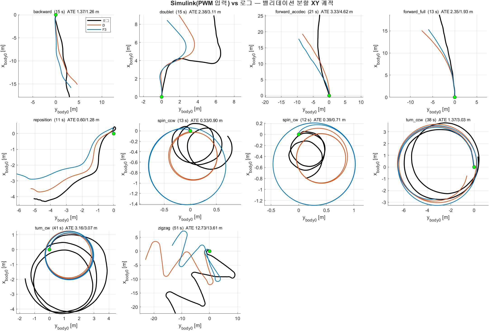
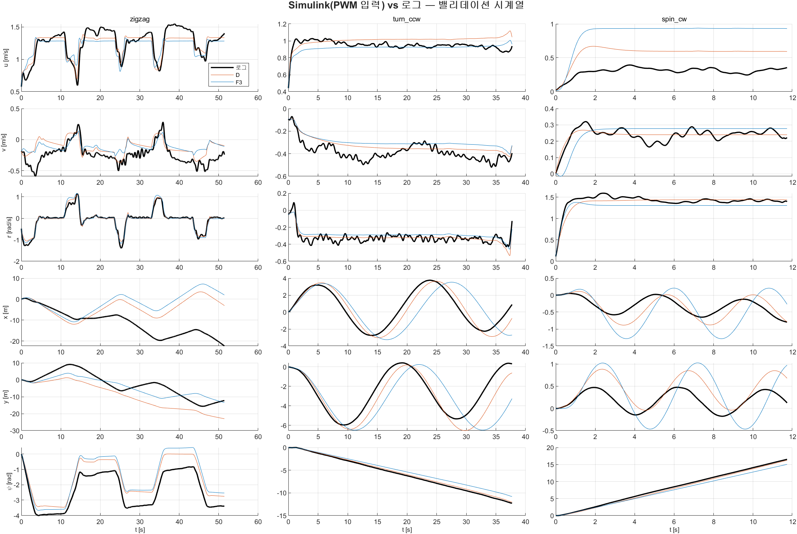

# 쌍동형 예인선 USV 의 3자유도 조종 동역학 식별 — 이론·방법·결과 통합본

**Tug 1: 완전구동 쌍동형 무인수상정의 출력오차 기반 3자유도 조종 모델 식별과 궤적 수준 검증**

윤원근 · AI 필드 로보틱스 연구실 (ANSL), 충남대학교 자율운항시스템공학과
작성 2026-11-21 · 저장소 [`wkyouncnu/tug1-3dof-sysid`](https://github.com/wkyouncnu/tug1-3dof-sysid)

> **이 문서의 위치.** 본 문서는 [`THEORY.md`](THEORY.md)(이론), [`METHOD.md`](METHOD.md)(절차),
> [`RESULTS.md`](RESULTS.md)(수치)를 **논문 체계로 통합한 단일 문서**다. 중복을 제거하고
> 수식을 LaTeX 로, 절차를 알고리즘으로 다시 썼다. 세 개별 문서는 세부 참조용으로 그대로 남겨 둔다.
> PDF 판: [`PAPER.pdf`](PAPER.pdf).
>
> **조판 경로 메모.** 본 문서의 PDF 는 `PAPER.tex` 를 **XeLaTeX + xeCJK** (TinyTeX / TeX Live 2026)
> 로 직접 조판했다. 저장소의 `tools/md2html.py` + Chrome 인쇄 경로는 Markdown 을 HTML 로만 바꾸므로
> `$...$` 수식을 조판하지 못한다. 한글 조판은 `NanumMyeongjo`(본문) / `Malgun Gothic`(산세리프·고정폭)
> 으로 해결되어 KaTeX/MathJax 대체 경로는 사용하지 않았다.

---

## 초록

실물 쌍동형 예인선 무인수상정(USV) **Tug 1** (1.1 × 0.53 × 0.53 m, 17.86 kg, Pixhawk, Blue
Robotics T200 ×3 — 후미 2기 + **선수 횡방향 1기**)의 3자유도 조종 동역학을 **144개 Pixhawk
ULog** 로부터 식별하고 궤적 수준에서 검증했다. 선수 횡방향 추진기 덕분에 배분행렬이
정방·가역($\det\mathbf{T} = 2d = 0.6$)이어서 이 선박은 **3자유도 완전구동**이며, 부족구동 USV
문헌과 달리 sway 를 직접 구동할 수 있다.

식별의 핵심 발견은 **로그에 기록된 $\boldsymbol{\tau}$ 가 작용력이 아니라는 것**이다. 조종기에
sway 스틱이 없어 로그의 $\tau_y$ 는 143개 로그 전 구간에서 정확히 0 이지만, 온보드 추력배분의
$Y = 0$ 분기가 항상 선택된 결과 **선수 추진기가 모든 기동에서 주 yaw 구동기로 동작했다**. 실제
작용력은 기록된 PWM 에 T200 곡선(18.5 V)을 통과시켜 재구성해야 하며, 재구성된 $\tau_y$ 는
$[-29.4, +37.1]$ N 의 범위를 갖는다.

식별은 **완전재귀 RK4 롤아웃에 대한 출력오차(output-error) 최적화**로 수행했다 — 수용 기준이
궤적이므로 목적함수도 궤적이어야 한다. 6개 구조후보를 비교해 **속도의존 유효추력 가설을 기각**했고
($\zeta$ 가 0.31 → 0.96 및 432 로 악화), 그 결과 선수 추진기 모멘트팔 $l_3$ 는 운동방정식에
나타나지 않고 추력배분 전단에만 쓰인다는 사실이 확정되었다. 최종 모델은 22항(F3)과 23항(D)
두 구조이며 궤적 성능이 사실상 동일하다 — 서로 다른 계수 집합이 같은 궤적을 만드는
식별성 한계의 직접 증거다.

**파일 단위 층화 분할**(train 78 / val 31 / test 34, 각 기동 종류의 가장 긴 기동이 test)에서
**test 성능이 val 성능보다 나쁘지 않았다** (5 s 창 $\zeta$: test 0.296 vs val 0.308). 식별에
쓰지 않은 val 31개 로그의 **PWM 을 그대로 Simulink 모델에 넣은 독립 검증**에서 창 단위 RMS
ATE 2.45 m / 주행거리 17.46 m (14.7 %)를 얻었고, 제어 지평에 해당하는 2–5 s 창에서는
ATE 0.23–0.79 m (선체길이의 0.2–0.7배)였다. N-step 곡선은 속도오차가 $N \approx 25$ (0.5 s)
에서 포화하고 **위치오차만 단조증가**함을 보여, 잔존 오차가 수치 불안정이 아니라 추측항법
적분 누적임을 입증한다.

남은 한계는 정직하게 기록한다: 18.5 V 를 로그로 검증할 수 없고, $\mathrm{corr}(\tau_y, \tau_N)
= 0.959$ 로 sway–yaw 계수를 깨끗하게 분리할 수 없으며($\because$ 순수 crabbing 기동 부재),
$m_{22}$·$m_{33}$ 가 물리적 기대치를 초과한다. 세 한계는 **계류추력 시험(bollard pull)** 과
**순수 crabbing 기동 추가 수집**으로 동시에 해소될 수 있다.

**키워드** — 무인수상정, 쌍동선, 3자유도 조종 모델, 시스템 식별, 출력오차법, 완전구동
추력배분, Pixhawk ULog, 궤적 수준 검증

---

## 1. 서론

### 1.1 배경과 목적

무인수상정의 제어기 설계·강화학습 환경·항적 예측은 모두 **조종 운동모델**을 전제한다.
전산유체해석이나 모형시험 없이 운용 로그만으로 이 모델을 얻는 것이 시스템 식별의 과제다.
본 연구의 목적은 단일하다 — **같은 PWM 을 넣으면 같은 궤적이 나오는 3자유도 모델**을
실물 로그로부터 얻고, 그 품질을 궤적 수준에서 정량화하는 것.

계수의 물리적 해석은 **2차 목표**로 둔다. §9.2–9.3 에서 보듯 현재 데이터만으로는 추력
스케일과 유효질량이 분리되지 않으므로, 계수를 유체력학적으로 해석하는 것은 계류추력
시험 이후의 일이다. 이 우선순위는 후속 과제(강화학습 운동모델)의 요구와 일치한다.

### 1.2 대상 선박

| 항목 | 값 |
|---|---|
| 선형 | 쌍동선(catamaran) 예인선 |
| 치수 ($L \times B \times H$) | $1.1 \times 0.53 \times 0.53$ m |
| 선체질량 $m$ | 17.86 kg |
| 추진 | Blue Robotics T200 ×3 — 후미 2기($+X_b$) + **선수 1기($+Y_b$, 횡방향 전용)** |
| 전압 | 18.5 V (사용자 진술, 로그 검증 실패 — §9.9) |
| PWM 권한 | $[1200, 1800]$ µs |
| 비행제어기 | Pixhawk (로그 = ULog) |
| 좌표계 | PX4 = NED 월드 + FRD 바디 = Fossen/SNAME |

**선수 횡방향 추진기가 이 선박의 하드웨어적 차별점이다.** 후미 2기만 있는 부족구동 USV 는
$\tau_y \equiv 0$ 이므로 sway 를 $-ur$ 원심결합으로만 간접 여기할 수 있다. 이 선박은 직접 줄 수 있다.

### 1.3 기여

1. **로그 $\boldsymbol{\tau}$ 의 함정을 규명했다.** 기록된 $\tau_y \equiv 0$ 과 실제 작용력
   $\tau_y \in [-29.4, +37.1]$ N 의 괴리, 그리고 그 원인인 $Y=0$ 분기의 고정 선택(§4.5).
   이 단계를 건너뛰면 완전히 틀린 모델이 나온다.
2. **궤적 수준 수용 기준과 일치하는 목적함수를 썼다.** 1-step 최소자승이 아니라 완전재귀
   RK4 롤아웃 출력오차(§5.1). 두 목적함수는 서로 다른 최적점을 준다.
3. **속도의존 유효추력 가설을 실측으로 기각했다**(§9.1). 결과적으로 $l_3$ 가 운동방정식에
   나타나지 않음이 확정되어 모델이 단순해졌다.
4. **분할 오염이 없는 평가 프로토콜.** 파일 단위 층화 분할 + 가장 어려운 기동을 test 로
   보내는 규칙(§8.2), 그 위에서 test ≥ val 을 입증(§9.4).
5. **독립 검증.** 식별에 쓰지 않은 31개 로그의 PWM 을 Simulink 모델에 그대로 넣어 비교
   (§9.7). 입력 경로가 다르므로 원리적으로 동일할 수 없는데 편차가 최대 3.3 cm 다.
6. **식별성 한계를 숨기지 않고 정량화했다.** $\mathrm{corr}(\tau_y,\tau_N) = 0.959$, 선수
   추진기 포화율 33.1 % 가 유일한 분리정보라는 진단(§9.3).

### 1.4 범위

**3자유도만** 다룬다. roll 은 $r$ 과 $\mathrm{corr} = -0.9036$ 으로 거의 공선이어서 4번째
자유도를 넣을 근거가 없다(§9.8). **Tug 1 만** 다룬다. **운동모델 검증까지만** 다루며
강화학습 적용은 후속 과제다.

### 1.5 문서 구성

§2–3 좌표계와 운동방정식, §4 추진계와 작용력, §5 식별 정식화, §6 평가지표, §7 알고리즘 6개,
§8 데이터셋, §9 결과, §10 논의와 한계, §11 재현성. 부록 A 기호표.

---

## 2. 좌표계와 상태

### 2.1 프레임 규약

| 프레임 | 정의 |
|---|---|
| 월드(관성) | **NED** — $x$ 북, $y$ 동, $z$ 하 |
| 바디 | **FRD** — $x$ 선수, $y$ 우현, $z$ 하 |

**PX4 는 월드 NED · 바디 FRD 를 쓰며 이는 Fossen/SNAME 규약과 동일하다.** 따라서 ULog 에서
읽은 값을 그대로 운동방정식에 넣을 수 있고 **부호 반전이 없다**. ROS/Gazebo 의 ENU 월드 +
FLU 바디 파이프라인과 섞으면 sway·yaw 가 통째로 틀린다. 본 저장소는 PX4 데이터만 다룬다.

### 2.2 상태벡터와 기구학

$$
\boldsymbol{\nu} = \begin{bmatrix} u \\ v \\ r \end{bmatrix}, \qquad
\boldsymbol{\eta} = \begin{bmatrix} x \\ y \\ \psi \end{bmatrix}
\tag{1}
$$

$\boldsymbol{\nu}$ 는 바디 속도(surge, sway, yaw rate), $\boldsymbol{\eta}$ 는 월드 위치와 선수방위다.

$$
\dot{\boldsymbol{\eta}} = \mathbf{R}(\psi)\,\boldsymbol{\nu}, \qquad
\mathbf{R}(\psi) = \begin{bmatrix}
\cos\psi & -\sin\psi & 0 \\
\sin\psi & \cos\psi & 0 \\
0 & 0 & 1
\end{bmatrix}
\tag{2}
$$

성분별로,

$$
\dot{x} = u\cos\psi - v\sin\psi, \qquad
\dot{y} = u\sin\psi + v\cos\psi, \qquad
\dot{\psi} = r
\tag{3}
$$

### 2.3 월드 NED 속도 → 바디 FRD 속도 (유도 ⑥)

ULog 의 `vehicle_local_position.vx/vy/vz` 는 **월드 NED** 성분이다. $\mathbf{R}(\psi)$ 가
직교행렬이므로 역변환은 전치다. 식 (2) 의 상위 $2\times2$ 블록을 $\mathbf{R}_2(\psi)$ 라 하면

$$
\begin{bmatrix} u \\ v \end{bmatrix}
= \mathbf{R}_2(\psi)^{\!\top} \begin{bmatrix} v_N \\ v_E \end{bmatrix}
= \begin{bmatrix} \cos\psi & \sin\psi \\ -\sin\psi & \cos\psi \end{bmatrix}
\begin{bmatrix} v_N \\ v_E \end{bmatrix}
\tag{4}
$$

$$
\boxed{\;u = v_N\cos\psi + v_E\sin\psi, \qquad v = -v_N\sin\psi + v_E\cos\psi\;}
\tag{5}
$$

$r$ 은 `vehicle_angular_velocity.xyz(3)` 로 **이미 바디 FRD** 이므로 변환하지 않는다.

실제 구현은 $\psi$ 만 쓰는 식 (5) 대신 쿼터니언 $\mathbf{q} = [q_0, q_1, q_2, q_3]^\top$ 에서
만든 전체 방향코사인행렬 $\mathbf{R}_b^n(\mathbf{q})$ 를 써서 roll/pitch 가 섞인 효과까지
반영한 뒤 수평성분을 취한다:

$$
\boldsymbol{\nu}_{\text{lin}} = \mathbf{R}_b^n(\mathbf{q})^{\!\top}
\begin{bmatrix} v_N \\ v_E \\ v_D \end{bmatrix}, \qquad
\psi = \operatorname{atan2}\!\big(2(q_0q_3 + q_1q_2),\; 1 - 2(q_2^2 + q_3^2)\big)
\tag{6}
$$

---

## 3. 3자유도 운동방정식

### 3.1 일반형

$$
\mathbf{M}\dot{\boldsymbol{\nu}} + \mathbf{C}(\boldsymbol{\nu})\boldsymbol{\nu}
+ \mathbf{D}(\boldsymbol{\nu})\boldsymbol{\nu} + \mathbf{d}_0 = \boldsymbol{\tau}
\tag{7}
$$

| 항 | 의미 |
|---|---|
| $\mathbf{M}$ | 질량/관성 행렬. **강체질량 + 부가질량의 합산 유효질량** |
| $\mathbf{C}(\boldsymbol{\nu})$ | 코리올리·원심력 (강체 + 부가질량분) |
| $\mathbf{D}(\boldsymbol{\nu})$ | 유체 감쇠. 선형항 + 2차(모듈러) 항 |
| $\mathbf{d}_0$ | 상수 편향. 트림·정렬오차·잔류 외란 흡수 |
| $\boldsymbol{\tau}$ | 추진기 작용력/모멘트 $[\tau_x, \tau_y, \tau_N]^\top$ |

### 3.2 질량·관성 행렬 (유도 ①)

$\mathbf{M} = \mathbf{M}_{RB} + \mathbf{M}_A$ 로 분해한다. 질량중심이 선수방향으로 $x_g$
떨어져 있을 때 3자유도 강체 질량행렬은

$$
\mathbf{M}_{RB} = \begin{bmatrix}
m & 0 & 0 \\
0 & m & m x_g \\
0 & m x_g & I_z
\end{bmatrix}
\tag{8}
$$

부가질량행렬은 SNAME 유체력 도함수 표기로

$$
\mathbf{M}_A = -\begin{bmatrix}
X_{\dot u} & 0 & 0 \\
0 & Y_{\dot v} & Y_{\dot r} \\
0 & N_{\dot v} & N_{\dot r}
\end{bmatrix}
\tag{9}
$$

좌우대칭 선체에서 surge 는 sway/yaw 와 연성되지 않으므로 $X_{\dot v} = X_{\dot r} = 0$ 이고,
가속도 포텐셜의 상반성(reciprocity)에서 $Y_{\dot r} = N_{\dot v}$ 이다. 따라서 합산 행렬은
대칭이며

$$
\mathbf{M} = \begin{bmatrix}
m_{11} & 0 & 0 \\
0 & m_{22} & m_{23} \\
0 & m_{23} & m_{33}
\end{bmatrix},
\qquad
\begin{aligned}
m_{11} &= m - X_{\dot u} \\
m_{22} &= m - Y_{\dot v} \\
m_{23} &= m x_g - Y_{\dot r} \\
m_{33} &= I_z - N_{\dot r}
\end{aligned}
\tag{10}
$$

**$m x_g$ 와 $Y_{\dot r}$ 는 분리할 수 없다.** 정역학적 CoG 오프셋과 부가질량 연성항이 운동
방정식에 **같은 형태로** 들어가므로 하나의 파라미터 $m_{23}$ 로 묶는다. 분리하려면 CoG 를
독립 계측해야 한다.

$m_{11}$ 은 **선체질량 17.86 kg 에 고정**했다 (즉 $X_{\dot u} = 0$ 가정). 근거는 §5.3 이다.

**★ 구조적으로 중요한 사실.** $m_{11}$ 과 $m_{22}$ 는 식 (7) 의 **세 방정식에 동시에
나타난다** — 자기 방정식의 $\mathbf{M}\dot{\boldsymbol{\nu}}$ 항에서, 그리고 다른 방정식의
$\mathbf{C}(\boldsymbol{\nu})\boldsymbol{\nu}$ 항에서(§3.3). 이것이 추력 스케일과 감쇠
스케일의 전역 축퇴를 부분적으로 깨는 **유일한 구조적 장치**다.

### 3.3 코리올리·원심력의 반대칭 전개 (유도 ②)

$\mathbf{M}$ 이 식 (10) 의 형태일 때 에너지 보존을 만족하는
**반대칭(skew-symmetric)** 코리올리 행렬은

$$
\mathbf{C}(\boldsymbol{\nu}) = \begin{bmatrix}
0 & 0 & -m_{22}v - m_{23}r \\
0 & 0 & m_{11}u \\
m_{22}v + m_{23}r & -m_{11}u & 0
\end{bmatrix},
\qquad \mathbf{C}^{\!\top} = -\mathbf{C}
\tag{11}
$$

반대칭성은 $\boldsymbol{\nu}^\top\mathbf{C}(\boldsymbol{\nu})\boldsymbol{\nu} = 0$ 을 보장한다
— 코리올리 항이 운동에너지를 넣거나 빼지 않는다는 물리 요구다. 곱을 성분별로 전개하면

$$
\mathbf{C}(\boldsymbol{\nu})\boldsymbol{\nu} =
\begin{bmatrix}
0\cdot u + 0\cdot v + (-m_{22}v - m_{23}r)\,r \\
0\cdot u + 0\cdot v + (m_{11}u)\,r \\
(m_{22}v + m_{23}r)\,u + (-m_{11}u)\,v + 0\cdot r
\end{bmatrix}
=
\begin{bmatrix}
-m_{22}\,v r - m_{23}\,r^2 \\
m_{11}\,u r \\
(m_{22} - m_{11})\,u v + m_{23}\,u r
\end{bmatrix}
\tag{12}
$$

**이 항들은 식별하지 않는다.** $m_{11}, m_{22}, m_{23}$ 이 정해지면 전부 결정된다. 두 가지
실패 양상이 있다:

- **빼면** 선회·지그재그 구간이 통째로 틀린다 (원심력이 sway 의 유일한 간접 여기 통로다).
- **자유계수로 두면** 감쇠항과 다중공선이 되어 식별이 무너진다 ($vr$, $ur$, $uv$ 는
  감쇠 후보항과 중복된다).

### 3.4 모듈러 감쇠와 상수편향 (유도 ③)

$\mathbf{D}(\boldsymbol{\nu})\boldsymbol{\nu} + \mathbf{d}_0$ 를 자유도별로 전개한다
(`tug1_dyn.m` 과 일치):

$$
\begin{aligned}
\big[\mathbf{D}\boldsymbol{\nu} + \mathbf{d}_0\big]_1 &=
X_u u + X_{uu}|u|u + X_{vv}|v|v + X_{rr}|r|r + X_0 \\[2pt]
\big[\mathbf{D}\boldsymbol{\nu} + \mathbf{d}_0\big]_2 &=
Y_v v + Y_{vv}|v|v + Y_r r + Y_{rr}|r|r + Y_{vr}|v|r + Y_0 \\[2pt]
\big[\mathbf{D}\boldsymbol{\nu} + \mathbf{d}_0\big]_3 &=
N_r r + N_{rr}|r|r + N_v v + N_{vv}|v|v + N_{uv}uv + N_{vr}|v|r + N_{ur}ur + N_0
\end{aligned}
\tag{13}
$$

**왜 모듈러형 $|\cdot|\cdot$ 인가.** 2차 감쇠는 운동을 거스르는 방향으로 작용해야 하므로
속도의 **기함수**여야 한다:

$$
f_{\text{mod}}(u) = X_{uu}|u|u \;\Rightarrow\; f_{\text{mod}}(-u) = -f_{\text{mod}}(u) \quad \text{(옳다)}
$$
$$
f_{\text{sq}}(u) = X_{uu}u^2 \;\Rightarrow\; f_{\text{sq}}(-u) = +f_{\text{sq}}(u) \quad \text{(후진에서 부호가 틀린다)}
\tag{14}
$$

이 선박은 **역추력이 정추력의 79 %** 이고 후진 기동(`backward`, `reposition`)이 데이터의
상당 부분이므로 이 구분이 실질적으로 중요하다.

항 선정의 근거:

- $X_{vv}, X_{rr}$ — 선회 중 저항 증가(쌍동선의 비대칭 유동, 선체 간 간섭)
- $N_{uv}, N_{ur}$ — 속도에 비례하는 조종 모멘트. 전형적인 Munk moment / 선회저항 연성
- $Y_{vr}, N_{vr}$ — sway–yaw 교차 2차항
- $X_0, Y_0, N_0$ — 상수 편향. 추력 비대칭·추진기 정렬오차·센서 바이어스를 흡수

### 3.5 상태공간 최종형과 파라미터 벡터

$$
\dot{\boldsymbol{\nu}} = \mathbf{M}^{-1}\big[\boldsymbol{\tau}
- \mathbf{C}(\boldsymbol{\nu})\boldsymbol{\nu}
- \mathbf{D}(\boldsymbol{\nu})\boldsymbol{\nu} - \mathbf{d}_0\big],
\qquad
\dot{\boldsymbol{\eta}} = \mathbf{R}(\psi)\boldsymbol{\nu}
\tag{15}
$$

$\mathbf{M}$ 의 구조 (10) 덕분에 역행렬은 닫힌형이다:

$$
\mathbf{M}^{-1} = \begin{bmatrix}
1/m_{11} & 0 & 0 \\
0 & m_{33}/\Delta & -m_{23}/\Delta \\
0 & -m_{23}/\Delta & m_{22}/\Delta
\end{bmatrix},
\qquad \Delta = m_{22}m_{33} - m_{23}^2
\tag{16}
$$

$\Delta > 0$ 이 양정치성 조건이며 최적화 중 이를 감시한다.

6차 상태와 23개 파라미터:

$$
\mathbf{s} = [u, v, r, x, y, \psi]^\top \in \mathbb{R}^6
\tag{17}
$$

$$
\boldsymbol{\theta} = \big[\,
\underbrace{m_{11}, m_{22}, m_{33}, m_{23}}_{\text{관성 4}},\;
\underbrace{X_u, X_{uu}, X_{vv}, X_{rr}, X_0}_{\text{surge 5}},\; \\
\underbrace{Y_v, Y_{vv}, Y_r, Y_{rr}, Y_{vr}, Y_0}_{\text{sway 6}},\;
\underbrace{N_r, N_{rr}, N_v, N_{vv}, N_{uv}, N_{vr}, N_{ur}, N_0}_{\text{yaw 8}}
\,\big]^\top
\tag{18}
$$

이 순서는 `tug1_model.m` 의 `ORD` 와 `tug1_dyn.m` 의 `p(1..23)` 과 **반드시** 일치한다.

---

## 4. 추진 시스템과 작용력

### 4.1 추진기 배치

$X_b$ 가 선수방향, $Y_b$ 가 우현방향(FRD)일 때:

| 추진기 | 위치 | 작용방향 |
|---|---|---|
| $f_1$ 좌현 후미 | $(-x_a,\, -d)$ | $+X_b$ |
| $f_2$ 우현 후미 | $(-x_a,\, +d)$ | $+X_b$ |
| $f_3$ 선수 | $(+l_3,\, 0)$ | $+Y_b$ (**횡방향 전용**) |

$d = 0.300$ m, $l_3 = 0.500$ m. 조향각은 없다 (고정 추진기).

### 4.2 추력배분 행렬과 닫힌형 역해 (유도 ④)

위치 $(x_i, y_i)$ 에서 힘 $\mathbf{F}_i = [F_{x,i}, F_{y,i}]^\top$ 가 작용할 때 FRD 에서
yaw 모멘트는 $N_i = x_i F_{y,i} - y_i F_{x,i}$ 다. 추진기별로:

$$
\begin{aligned}
f_1:&\quad F_x = f_1,\; F_y = 0 &\Rightarrow&\quad N_1 = -(-d)f_1 = +d\,f_1 \\
f_2:&\quad F_x = f_2,\; F_y = 0 &\Rightarrow&\quad N_2 = -(+d)f_2 = -d\,f_2 \\
f_3:&\quad F_x = 0,\; F_y = f_3 &\Rightarrow&\quad N_3 = (+l_3)f_3 = +l_3 f_3
\end{aligned}
\tag{19}
$$

합산하면

$$
\boldsymbol{\tau} =
\begin{bmatrix} X \\ Y \\ N \end{bmatrix}
= \underbrace{\begin{bmatrix}
1 & 1 & 0 \\
0 & 0 & 1 \\
d & -d & l_3
\end{bmatrix}}_{\mathbf{T}}
\begin{bmatrix} f_1 \\ f_2 \\ f_3 \end{bmatrix}
= \mathbf{T}\mathbf{f}
\tag{20}
$$

2행을 따라 전개하면 행렬식은

$$
\det\mathbf{T} = (-1)^{2+3}\cdot 1 \cdot
\det\!\begin{bmatrix} 1 & 1 \\ d & -d \end{bmatrix}
= -(-d - d) = 2d = 0.6 \neq 0
\tag{21}
$$

**$\mathbf{T}$ 는 정방·가역이다 ⇒ 3자유도 완전구동이고 중복이 없다.** 의사역행렬이나 최적화
기반 배분이 필요 없고 닫힌형 역해가 유일하게 존재한다. 식 (20) 의 1·3 행에서

$$
f_1 + f_2 = X, \qquad d(f_1 - f_2) = N - l_3 Y
\;\Longrightarrow\;
f_1 - f_2 = \frac{N - l_3 Y}{d}
\tag{22}
$$

$$
\boxed{\;
f_3 = Y, \qquad
f_1 = \frac{X}{2} + \frac{N - l_3 Y}{2d}, \qquad
f_2 = \frac{X}{2} - \frac{N - l_3 Y}{2d}
\;}
\tag{23}
$$

행렬형으로는

$$
\mathbf{T}^{-1} = \begin{bmatrix}
\tfrac12 & -\tfrac{l_3}{2d} & \tfrac{1}{2d} \\[4pt]
\tfrac12 & \tfrac{l_3}{2d} & -\tfrac{1}{2d} \\[4pt]
0 & 1 & 0
\end{bmatrix}
\tag{24}
$$

**부족구동 USV 와의 대비.** 후미 2기만 있으면 $\mathbf{T}$ 의 2행이 $[0\;0\;0]$ 이 되어
$\tau_y \equiv 0$ 이고, sway 는 식 (12) 의 $-m_{22}vr$ 원심결합으로만 간접 여기된다.
직진($r\approx0$)이나 제자리선회($u\approx0$)에서는 $v \equiv 0$ 이므로 sway 데이터가 아예
생기지 않는다. **이 선박은 $f_3$ 로 직접 줄 수 있다.**

### 4.3 순수 crabbing 의 실현 조건 (유도 ⑤)

$u \approx 0,\ r \approx 0,\ v \neq 0$ 을 유지하면 $Y_v$, $Y_{vv}$, $m_{22}$ 가 다른 자유도와
**완전히 분리되어** 식별된다 — 식 (13) 의 sway 식에서 $r$ 관련 항이 모두 사라지기 때문이다.

문제는 선수 추진기가 $Y$ 를 주는 동시에 $l_3 Y$ 의 yaw 모멘트를 만든다는 것이다. $N = 0$ 을
유지하려면 식 (23) 에서 $X = 0, N = 0$ 을 넣어

$$
f_3 = Y, \qquad f_1 = -\frac{l_3 Y}{2d}, \qquad f_2 = +\frac{l_3 Y}{2d}
\tag{25}
$$

즉 **후미 한 기가 반드시 역추력을 내야 한다.** T200 의 역추력 한계를 $f_{\min}$
(부호 포함, $f_{\min} < 0$), 정추력 한계를 $f_{\max}$ 라 하면 실현 조건은

$$
\left|\frac{l_3 Y}{2d}\right| \le |f_{\min}|
\quad\text{and}\quad
|Y| \le f_{\max}
\tag{26}
$$

$$
\boxed{\;
Y_{\max} = \min\!\left(f_{\max},\; |f_{\min}|\cdot\frac{2d}{l_3}\right)
= \min\!\left(37.11,\; 29.41 \times \frac{0.6}{0.5}\right)
= \min(37.11,\; 35.29) = 35.3\ \text{N}
\;}
\tag{27}
$$

제약을 거는 것은 **역추력 한계**이며, $2d/l_3 = 1.2 > 1$ 이므로 기하 비율은 유리한 편이다.

**보유 데이터에는 순수 crabbing 기동이 없다.** 이것이 §9.3 공선성 한계의 직접 원인이다.

### 4.4 T200 PWM–추력 곡선 (18.5 V)

제조사 공개 성능표에서 18.5 V 열만 추출해 균일격자로 재구성했다.

| 항목 | 값 |
|---|---|
| PWM 격자 | $1200 : 4 : 1800$ µs (151점) |
| 데드밴드 | $[1476, 1528]$ µs (14 격자점, 추력 **정확히** 0) |
| 추력 범위 | $-29.4138 \ \ldots\ +37.1093$ N |
| 정/역 비대칭 | 역추력 = 정추력의 **79 %** |
| 2차 모델 $f = k n^2$ 적합도 | $R^2 = 0.99973$, RMSE $= 0.266$ N |



**그림 1.** T200 PWM–추력 곡선 (18.5 V). 좌: PWM 대 추력, 균일격자 151점과 데드밴드
$[1476,1528]$ µs 의 정확히 0 인 구간. 우: 회전수–추력 2차 모델 $f = k n^2$ 의 정·역방향
개별 적합($R^2 = 0.99973$, RMSE 0.266 N). 역추력이 정추력의 79 % 인 비대칭이 crabbing
진폭 한계(식 27)와 후진 기동의 모델링을 모두 제약한다.

⚠️ **룩업 범위 주의.** 저장 구조체의 `f_max`/`f_min` **필드**($+36.443 / -28.590$ N)는
2차 모델의 극값이다. 룩업에는 **격자 벡터 `f` 의 실제 범위**($+37.1093 / -29.4138$ N)를
써야 한다.

Simulink 구현은 격자 벡터를 그대로 **1-D Lookup Table** 의 breakpoint/table 로 넣는다.
데드밴드가 표 자체에 0 으로 들어 있어 **별도 데드밴드 블록이 필요 없다**. 두 벡터가 모두
단조이므로 보간이 유효하다.

### 4.5 ★ 로그의 $\boldsymbol{\tau}$ 를 믿으면 안 되는 이유

#### 4.5.1 온보드 지령 사슬 (Simulink 역공학 결과)

데이터를 보기 전에 **"그 데이터가 어떻게 만들어졌는지"** 를 확정해야 한다. 온보드 모델을
블록 단위로 추적해 복원한 사슬:

$$
\begin{array}{l}
\text{RC ch3(surge), ch1(yaw), ch5(arm), ch7(enable)} \\
\quad\downarrow\ [-1,1]\ \text{정규화} \\
\quad\downarrow\ \text{스틱 데드밴드 (surge } \pm0.10,\ \text{yaw } \pm0.05) \\
\boldsymbol{\tau}_{RC} = [s_x,\ \mathbf{0},\ s_N]^\top
\quad \leftarrow \text{★ } Y \text{ 채널이 Constant 0 으로 하드와이어} \\
\quad\downarrow\ \text{구간별 이득: } s_x<0\,?\,{\times}56.66:{\times}71.71 \ ;\quad
s_N<0\,?\,{\times}33.42:{\times}37.18 \\
\textbf{★ 여기까지가 로그의 } \mathtt{taux/tauy/taun} \textbf{ 이다 (배분 전 지령)} \\
\quad\downarrow\ \text{daisy-chain 추력배분: }
u_3 = \operatorname{clamp}(N/l_3,\, u_3^{\min},\, u_3^{\max}),\quad
N_{\text{res}} = N - l_3 u_3 \\
\qquad\qquad f_1 = X/2 + N_{\text{res}}/(2d),\quad
f_2 = X/2 - N_{\text{res}}/(2d),\quad f_3 = u_3 \\
\quad\downarrow\ n_i = \operatorname{sign}(f_i)\sqrt{|f_i|/k(\operatorname{sign})}
\quad \leftarrow \text{로그의 } \mathtt{motor1..3} \\
\quad\downarrow\ \text{모터 데드밴드 게이트} \pm33\ \text{rad/s}\ (\Leftrightarrow |f| \le 0.40\ \text{N}) \\
\quad\downarrow\ n \to \text{PWM 룩업} \\
\quad\downarrow\ \text{Saturation } [1200, 1800]
\quad \leftarrow \text{로그의 } \mathtt{spare\_one/two/three}
\end{array}
$$

#### 4.5.2 결정적 사실

**로그의 $\tau_y$ 가 전 구간 정확히 0 이다** — 143개 로그에서 $\max|\tau_{y,\text{cmd}}|
= 0.000\mathrm{e}{+}00$. 조종기에 sway 스틱이 없어 $Y$ 입력이 Constant 0 으로 고정되어 있다.

그 결과 추력배분의 $Y = 0$ 분기가 **항상** 선택되고, 그 분기에서 선수 추진기가 포화하지
않는 동안

$$
f_3 = \frac{N}{l_3} \quad\Longrightarrow\quad
\tau_y = f_3 = \frac{\tau_N}{l_3} = 2\,\tau_N \quad (l_3 = 0.5)
\tag{28}
$$

즉 **선수 추진기가 모든 기동에서 주 yaw 구동기로 동작했다.** 로그의 $\tau_y = 0$ 과 실제
작용 $\tau_y \in [-29.4, +37.1]$ N 은 완전히 다르다.

$$
\boxed{\;\text{로그의 } \mathtt{taux/tauy/taun} \text{ 은 배분 전 지령이며 작용력이 아니다.}
\;\text{작용력은 PWM 에서 재구성해야 한다.}\;}
$$

#### 4.5.3 PWM 을 1차 기준으로 삼은 이유

$\mathtt{motor1..3}$(지령 회전수)에서 역산한 PWM 과 로그 PWM 이 최대 **73 µs** 어긋났다 —
온보드 룩업표와 `t200_fit` 의 역변환이 완전히 같지 않기 때문이다. **ESC 가 실제로 받는
신호는 PWM 이므로 PWM 이 진실이다.**



**그림 2.** 밸리데이션 로그의 입력 신호 3층 비교. 상단: 기록된 PWM 3채널
($\mathtt{spare\_one/two/three}$, 권한 $[1200,1800]$ µs). 중단: 식 (29) 로 재구성한 작용력
$\boldsymbol{\tau} = \mathbf{T}\mathbf{f}$ — $\tau_y$ 가 $[-29.4, +37.1]$ N 을 왕복한다.
하단: 로그에 기록된 배분 전 지령 $\mathtt{taux/tauy/taun}$ — **$\mathtt{tauy}$ 가 전 구간
정확히 0 인 직선**이다. 중단과 하단의 괴리가 §4.5 의 핵심이며, 하단을 그대로 믿고 식별하면
완전히 틀린 모델이 나온다.

---

## 5. 식별 정식화

### 5.1 출력오차(output-error) 목적함수 (유도 ⑦)

**1-step 최소자승이 아니다.** 수용 기준이 완전재귀 롤아웃 궤적이므로 목적함수도 그래야
한다. 두 목적함수는 **서로 다른 최적점을 준다** — 1-step 잔차가 더 작은 파라미터가 롤아웃에서
더 나쁠 수 있고, 실제로 그랬다.

창 $w$ (활성구간을 겹치지 않게 자른 구간, 샘플 $k = 0 \ldots N_w$)에 대해 **초기상태만**
실측으로 주고 끝까지 적분한다:

$$
\hat{\mathbf{s}}^w(0) = \big[u_m(a_w),\ v_m(a_w),\ r_m(a_w),\ 0,\ 0,\ 0\big]^\top
\tag{29}
$$

$$
\hat{\mathbf{s}}^w(k{+}1) = \Phi_{RK4}\!\big(\hat{\mathbf{s}}^w(k),\,
\boldsymbol{\tau}(t_k),\, \boldsymbol{\tau}(t_{k+1}),\, \boldsymbol{\theta},\, h\big),
\qquad h = T_s = 0.02\ \text{s}
\tag{30}
$$

RK4 연산자는 식 (15) 의 우변을 $\mathbf{g}(\mathbf{s}, \boldsymbol{\tau}; \boldsymbol{\theta})$
라 할 때

$$
\begin{aligned}
\mathbf{k}_1 &= \mathbf{g}\big(\mathbf{s},\ \boldsymbol{\tau}(t_1)\big) \\
\mathbf{k}_2 &= \mathbf{g}\big(\mathbf{s} + \tfrac{h}{2}\mathbf{k}_1,\ \boldsymbol{\tau}(t_m)\big) \\
\mathbf{k}_3 &= \mathbf{g}\big(\mathbf{s} + \tfrac{h}{2}\mathbf{k}_2,\ \boldsymbol{\tau}(t_m)\big) \\
\mathbf{k}_4 &= \mathbf{g}\big(\mathbf{s} + h\,\mathbf{k}_3,\ \boldsymbol{\tau}(t_2)\big) \\
\mathbf{s}^{+} &= \mathbf{s} + \tfrac{h}{6}\big(\mathbf{k}_1 + 2\mathbf{k}_2 + 2\mathbf{k}_3 + \mathbf{k}_4\big)
\end{aligned}
\qquad
\boldsymbol{\tau}(t_m) = \tfrac12\big(\boldsymbol{\tau}(t_1) + \boldsymbol{\tau}(t_2)\big)
\tag{31}
$$

중간스텝 입력을 **선형보간**하는 것이 Simulink `From Workspace` 의 `Interpolate = on` 과
등가인 조건이다(§9.7.2).

목적함수는 채널별 표준편차로 정규화한 잔차의 제곱합이다:

$$
J(\boldsymbol{\theta}) = \sum_{w=1}^{W}\ \sum_{k=0}^{N_w}\
\sum_{\chi \in \{u,v,r,x,y,\psi\}}
\left(\frac{\hat{s}^w_\chi(k;\boldsymbol{\theta}) - z^w_\chi(k)}{\sigma_\chi}\right)^{\!2},
\qquad
\hat{\boldsymbol{\theta}} = \arg\min_{\boldsymbol{\theta}} J(\boldsymbol{\theta})
\tag{32}
$$

$\sigma_\chi$ 는 해당 채널 측정값의 표준편차이며, $u,v,r$ 과 $x,y,\psi$ 의 단위·크기 차이를
흡수한다. `lsqnonlin` (trust-region-reflective) 으로 푼다.

### 5.2 창 시작 바디 프레임 회전 — 가장 틀리기 쉬운 지점

식 (29) 가 $\hat{x} = \hat{y} = \hat{\psi} = 0$ 으로 시작하므로 롤아웃 출력 $\hat{x}, \hat{y}$
는 **창 시작시점 바디 프레임 기준 변위**다. 반면 로그의 $x, y$ 는 전역 NED 다. 비교 전에
실측을 창 시작 프레임으로 돌려야 한다. $p_0 = \psi_m(a_w)$ 라 하면

$$
\begin{bmatrix} z^w_x(k) \\ z^w_y(k) \end{bmatrix}
= \begin{bmatrix} \cos p_0 & \sin p_0 \\ -\sin p_0 & \cos p_0 \end{bmatrix}
\begin{bmatrix} x_m(a_w{+}k) - x_m(a_w) \\ y_m(a_w{+}k) - y_m(a_w) \end{bmatrix},
\qquad
z^w_\psi(k) = \psi_m(a_w{+}k) - p_0
\tag{33}
$$

속도 채널은 이미 바디이므로 회전하지 않는다: $z^w_\chi = \chi_m(a_w{+}k)$ for
$\chi \in \{u, v, r\}$.

$$
\boxed{\;\text{이 회전을 빼먹으면 5 s 창 위치 RMSE 가 } 0.14\ \text{m} \to 4.06\ \text{m}
\text{ 로 뛴다.}\;}
$$

모델이 틀린 것처럼 보이지만 좌표계 불일치일 뿐이다. 이 버그를 한 번 겪었다.

### 5.3 추력스케일–감쇠스케일 축퇴와 세 가지 대응

**문제.** 정상상태($\dot u = 0$, 직진 $v = r = 0$)에서 식 (7) 의 surge 성분은

$$
\tau_x = X_u u + X_{uu}|u|u
\tag{34}
$$

추력이 실제로 $k$ 배라면($\tau_x \to k\tau_x$) $X$ 계수가 **전부 $k$ 배**로 나와 식 (34) 를
똑같이 만족한다. **추력 스케일과 감쇠 스케일이 정상상태에서 완전히 축퇴한다** — 궤적은
완벽히 맞는데 계수는 전부 틀린다.

**대응 3가지:**

1. **과도구간 포함.** 정지 출발에서는 $m_{11}\dot u(0) = \tau_x$, 즉
   $\dot u(0) = \tau_x / m_{11}$ 이므로
   **질량을 알면 추력이 절대값으로 결정된다.** 가감속(`forward_accdec`)·doublet 기동이
   데이터에 포함되어 있다.
2. **$m_{11}$ 을 선체질량 17.86 kg 에 고정.** surge 부가질량을 0 으로 가정하는 것과 같다.
   쌍동선 세장체에서는 보수적이지만 허용 가능한 근사이며, **이것이 전역 스케일의 기준점**이다.
3. **$m_{11}, m_{22}$ 의 방정식 간 공유.** 식 (12) 를 통해 $m_{22}$ 가 surge 식에,
   $m_{11}$ 이 sway·yaw 식에 나타난다. 전역 스케일을 일률적으로 키우면 코리올리 항의
   균형이 깨지므로 축퇴가 부분적으로 해소된다.

**남은 한계.** 그럼에도 $m_{22}$ 가 선체질량의 3.0–6.7배, $m_{33}$ 이 기하학적 추정의
5–7배로 나온다(§9.2). 부가질량만으로 설명되는 크기가 아니다. **근본 해결은 계류추력
시험(bollard pull)** 이다 — 로드셀에 계류하고 PWM 을 스윕해 $\text{PWM} \to \text{N}$ 을
직접 계측하면 식 (34) 의 좌변이 독립적으로 결정된다. 물에 띄우기 전에 할 수 있고 투자
대비 효율이 가장 높다.

### 5.4 속도 추정의 신뢰도

$v$ 는 직접 계측값이 아니라 GPS 속도벡터와 IMU 자세로부터 나온 **추정기 출력**이다.
대지속도 $V_g$ 와 표류각 $\beta = \text{course} - \text{heading}$ 으로

$$
v \approx -V_g \sin\beta
\quad\Longrightarrow\quad
\frac{\partial v}{\partial \psi} \approx V_g \cos\beta
\tag{35}
$$

즉 **heading 오차가 그대로 $v$ 오차가 된다**. 저속일수록 $V_g$ 가 작아 SNR 이 나빠지므로,
저속·단거리 기동(`reposition`, 저속 `backward`)에서 $v$ 의 신뢰도가 가장 낮다 — §9.7.1 의
개별 최악 사례가 정확히 이 조건이다.

식별 계수가 추정기 튜닝을 따라 움직일 수 있다는 뜻이다. 선박 쪽 문헌에서 $R = Q/\text{SNR}$
스윕으로 $N'_v$ 의 **부호가 뒤집힌** 사례가 보고되어 있다. **본 연구는 그 민감도 스윕을
수행하지 않았다 — 열린 한계로 기록한다**(§10.2-7).

### 5.5 무차원화를 쓰지 않은 이유

선박 조종 문헌의 표준인 **prime system** (SNAME 1950) 은 속도를 $U = \sqrt{u^2 + v^2}$ 로
나눈다:

$$
u' = \frac{u}{U},\quad v' = \frac{v}{U},\quad r' = \frac{rL}{U}
\tag{36}
$$

이 선박의 데이터는 **제자리 선회(spin), 제위치 조정(reposition), 정지 출발**이 큰 비중이고
그 구간에서 $U \to 0$ 이므로 **무차원 변수가 발산한다.**

대안은 $\sqrt{Lg}$ 로 정규화하는 **bis system** (Norrbin 1970) 이나 고정 $U_{\text{ref}}$
스케일링이다. 그러나 본 연구는 목적이 "궤적을 맞추는 운동모델"이고 **단일 선박·단일
조건**이므로 무차원화의 이득(선박 간 비교, 축척 외삽)이 없다. 대신 목적함수에서 채널별
표준편차 정규화만 수행했다(식 32).

---

## 6. 평가지표 (유도 ⑧)

### 6.1 정의

창 $w$ 의 샘플 수를 $N_w$, 창 개수를 $W$, 총 샘플을 $N_{\text{tot}} = \sum_w N_w$ 라 한다.

**채널별 RMSE** — 모든 창의 모든 시점을 모아 계산:

$$
\mathrm{RMSE}_\chi = \sqrt{\frac{1}{N_{\text{tot}}}
\sum_{w}\sum_{k} \big(\hat{s}^w_\chi(k) - z^w_\chi(k)\big)^2}
\tag{37}
$$

**$\zeta$ (속도 복합지표)** — 단위가 다른 세 속도채널을 표준편차로 정규화해 평균:

$$
\zeta = \frac{1}{3}\sum_{\chi \in \{u, v, r\}} \frac{\mathrm{RMSE}_\chi}{\sigma_\chi}
\tag{38}
$$

$\zeta = 0.30$ 은 "속도오차가 그 채널 표준편차의 30 %" 를 뜻한다. 무차원이므로 모델·분할
간 비교에 쓴다.

**순간 위치오차:**

$$
e_w(k) = \big\|\,(\hat{x}^w(k), \hat{y}^w(k)) - (z^w_x(k), z^w_y(k))\,\big\|_2
\tag{39}
$$

**★ ATE 두 집계방식.** 저장소의 두 평가 경로가 서로 다른 통계량을 쓴다:

$$
\mathrm{ATE}_p = \frac{1}{N_{\text{tot}}}\sum_{w}\sum_{k} e_w(k)
\qquad \text{(점 단위 평균절대오차)}
\tag{40}
$$

$$
\mathrm{ATE}_w = \frac{1}{W}\sum_{w}
\sqrt{\frac{1}{N_w}\sum_{k} e_w(k)^2}
\qquad \text{(창 단위 RMS)}
\tag{41}
$$

$\mathrm{ATE}_p$ 는 모든 시점을 동등하게 평균하므로 **긴 창이 지배한다**.
$\mathrm{ATE}_w$ 는 창마다 RMS 를 낸 뒤 창을 동등하게 평균하므로 **창 길이에 중립**이다.
같은 창 집합(val, 구간전체, 평균 주행거리 17.46 m)에서 $\mathrm{ATE}_p = 3.165$ m,
$\mathrm{ATE}_w = 2.450$ m 가 나온다. **모순이 아니라 통계량이 다른 것이다** — 51 s 짜리
지그재그 하나가 점 단위 집계를 끌어올린다.

> **주지표 선택.** 본 문서는 **창 단위 RMS $\mathrm{ATE}_w$ 를 주 지표**로 보고한다.
> 창 길이에 중립이고, 최종 독립 검증(§9.7)이 쓰는 통계량이기 때문이다. 점 단위
> $\mathrm{ATE}_p$ 는 구조후보 비교(§9.1)와 분할별 롤아웃(§9.4)에서만 나타나며, 해당 표에
> 어느 집계인지 **표마다 명시**한다. 수치를 인용할 때 반드시 아래 첨자를 함께 쓴다.[^ate]

[^ate]: 구현 상 $\mathrm{ATE}_p$ 는 `tug_eval.m` (§9.1, §9.2, §9.4, §9.5 의 표),
$\mathrm{ATE}_w$ 는 `run_slx_val.m` (§9.6, §9.7 의 표)에서 나온다. 두 경로를 섞어 비교하면
같은 모델이 다른 성능으로 보인다.

**최종오차 / 주행거리 정규화:**

$$
e_{\text{final}} = \frac{1}{W}\sum_w e_w(N_w),
\qquad
\bar{L} = \frac{1}{W}\sum_w \sum_k
\big\|(z^w_x, z^w_y)(k{+}1) - (z^w_x, z^w_y)(k)\big\|_2,
\qquad
\rho = \frac{\mathrm{ATE}}{\bar{L}}
\tag{42}
$$

$\rho$ (ATE/거리)는 길이가 다른 기동을 공정하게 비교하는 유일한 방법이다.

**N-step 예측오차 곡선** — 각 창을 실측으로 재초기화한 뒤 정확히 $N$ 스텝만 적분하고,
$N$ 스텝 뒤 시점의 오차만 모은다:

$$
\mathrm{RMSE}_\chi(N) = \sqrt{\frac{1}{|\mathcal{W}_N|}
\sum_{w \in \mathcal{W}_N} \big(\hat{s}^w_\chi(N) - z^w_\chi(N)\big)^2},
\qquad
\mathcal{W}_N = \{w : N_w \ge N\}
\tag{43}
$$

**지평 스윕** — 창 길이를 $H \in \{2, 5, 10\}$ s 로 바꿔 같은 데이터를 재분할해 집계.
개루프 누적과 모델 자체 오차를 분리한다.

### 6.2 왜 지평 스윕이 필요한가

한 번만 초기화해 끝까지 가면 위치오차는 속도오차의 시간적분이므로 **반드시** 자란다 —
이것은 모델 품질이 아니라 추측항법의 성질이다. 속도 RMSE 가 지평에 거의 무관하고
(§9.6: $u$ 0.165/0.160/0.162) 위치오차만 자란다는 사실을 보여야 **"불안정이 아니라 적분
누적"** 이라는 주장이 성립한다. 발산하는 모델은 속도오차도 함께 지수적으로 커진다 (§9.1 의
후보 `H` 가 그 예다).

또한 강화학습 환경은 **에피소드마다 초기화되고 제어기가 루프를 닫으므로** 짧은 지평
성능이 실제 사용조건이다. 같은 모델로 둘 다 보고한다.

---

## 7. 알고리즘

6개 알고리즘으로 파이프라인 전체를 기술한다. 의사코드는 언어 독립이며, 각 알고리즘의 실제
구현 파일을 §7.7 에 대응시킨다.

### 7.1 알고리즘 1 — ULog → 균일격자 상태표

**입력** ULog 파일 경로; 샘플주기 $T_s = 0.02$ s; T200 곡선 구조체
**출력** 상태표 $\mathcal{R} = \{t, u, v, r, x, y, \psi, \mathrm{pwm}_{1..3},
\boldsymbol{\tau}_{\text{cmd}}, \text{act}\}$; 유효성 플래그 `ok`

```
Algorithm 1: ULOG-TO-STATETABLE(path, Ts, T200)
 1  topics ← READ-ULOG(path)
 2  require {vehicle_local_position, vehicle_attitude,
 3           vehicle_angular_velocity, vehicle_gps_position, actuator_outputs}
 4  if any required topic missing then return ok ← false
 5  t0 ← max over topics of (first timestamp)          // 공통 유효구간 시작
 6  t1 ← min over topics of (last  timestamp)
 7  t  ← t0, t0+Ts, ..., t1                            // 균일 50 Hz 격자
 8  // --- 최근접/선형 정렬 (merge_asof(nearest, tol ≈ 20 ms) 상당) ---
 9  for each topic T and each used field φ do
10      φ_grid ← INTERP-LINEAR(T.timestamp, T.φ, t)
11      if max gap(T.timestamp) > tol then mark samples in that gap invalid
12  // --- 자세와 바디 속도 ---
13  for k ← 1 to |t| do
14      Rbn ← QUAT-TO-DCM(q_grid[k])                   // 식 (6)
15      ψ[k] ← atan2(2(q0q3+q1q2), 1-2(q2²+q3²))
16      [u,v,w]ᵀ[k] ← Rbnᵀ · [vN, vE, vD]ᵀ[k]          // 식 (4)-(6)
17      r[k] ← ω_body,z[k]                             // 변환 불필요 (FRD)
18  // --- 위치: EKF local 이 아니라 GPS 에서 만든다 ---
19  (lat0, lon0, alt0) ← first valid GPS fix
20  for k ← 1 to |t| do
21      (x[k], y[k]) ← LLA-TO-NED(lat[k], lon[k], alt[k], lat0, lon0, alt0, 'flat')
22  // --- PWM: 선형보간 (최근접 금지) ---
23  pwm_i ← INTERP-LINEAR(actuator_outputs.t, output_i, t),  i = 1,2,3
24  // --- 활성구간 마스크 ---
25  act ← (arm = on) ∧ (enable = on) ∧ (thrust command ≠ 0)
26  ok ← (|t| ≥ 2) ∧ (GPS fixed) ∧ (longest run of act ≥ 3.0 s)
27  return R, ok
```

**설계 근거 3가지.**

1. **위치는 GPS 에서 만든다.** `vehicle_local_position.x/y` 를 쓰지 않는다 — 그 값은 EKF
   로컬 원점이 재설정될 때 점프하며 로그마다 원점이 다르다. 첫 유효 GPS 샘플을 원점으로
   삼아 일관된 NED 위치를 만든다 (21행).
2. **PWM 은 반드시 선형보간.** 최근접 보간하면 데드밴드 경계($[1476,1528]$ µs)에서 계단이
   생겨 작용력이 튄다 (23행).
3. **$r$ 은 변환하지 않는다.** PX4 의 `vehicle_angular_velocity` 는 이미 바디 FRD 다 (17행).

**복잡도** $O(N_{\text{topics}} \cdot N)$, $N = |t|$. 메모리 $O(N)$.

### 7.2 알고리즘 2 — 기록 PWM 으로부터 작용력 재구성

**입력** $\mathrm{pwm}_{1..3}[k]$; T200 곡선 $(\mathbf{p}_{T200}, \mathbf{f}_{T200},
\mathbf{n}_{T200})$; 배분행렬 $\mathbf{T}$; 권한 $[P_{\text{lo}}, P_{\text{hi}}]$
**출력** 작용력 $\boldsymbol{\tau}[k] = [\tau_x, \tau_y, \tau_N]^\top$; 공선성 진단량

```
Algorithm 2: TAU-FROM-PWM(pwm, T200, T, Plo, Phi)
 1  // 데드밴드 구간을 곡선 자체에서 읽는다 (하드코딩 금지)
 2  db_lo ← min{ p ∈ T200.pwm : T200.n(p) = 0 }
 3  db_hi ← max{ p ∈ T200.pwm : T200.n(p) = 0 }
 4  for k ← 1 to N do
 5      for i ← 1 to 3 do
 6          q ← CLAMP(pwm_i[k], Plo, Phi)               // [1200, 1800]
 7          f_i ← INTERP-LINEAR(T200.pwm, T200.f, q)    // 격자 벡터 범위를 쓴다
 8          if db_lo ≤ q ≤ db_hi then f_i ← 0           // ★ 명시적 0
 9      τ[k] ← T · [f_1, f_2, f_3]ᵀ                     // 식 (20)
10  // --- 공선성 진단 (이 단계에서 반드시 본다) ---
11  c_yN ← CORR(τ_y, τ_N)
12  c_ry ← CORR(r,  τ_y)
13  sat  ← fraction of k with |f_3[k]| ≥ 0.95 · max|T200.f|
14  return τ, (c_yN, c_ry, sat)
```

**8행이 핵심이다.** 데드밴드를 보간에 맡기면 경계에서 0 이 아닌 미세 추력이 생긴다. 표
자체에 0 이 들어 있어도 클램프 후 보간하면 경계 격자점 사이에서 비영값이 나올 수 있으므로
구간 전체를 명시적으로 0 으로 강제한다.

**7행 주의.** 룩업 범위는 **격자 벡터 $\mathbf{f}_{T200}$ 의 실제 범위**
($+37.1093/-29.4138$ N)를 쓴다. 저장 구조체의 `f_max`/`f_min` 필드($+36.443/-28.590$ N)는
2차 모델의 극값이므로 쓰면 안 된다(§4.4).

**13행의 진단이 §9.3 의 근거다.** 선수 추진기가 포화하지 않는 동안 $f_3 = N/l_3$ 가 **정확히**
성립하므로 $\tau_y$ 와 $\tau_N$ 은 구조적으로 거의 같은 신호다(식 28). **포화 구간만이 두
신호를 분리하는 유일한 정보원**이며, 그 비율이 0.331 이다.

**복잡도** $O(3N\log|\mathbf{p}_{T200}|)$ (이진탐색 보간) 또는 균일격자이므로 $O(3N)$.

### 7.3 알고리즘 3 — Savitzky–Golay 미분과 선형 LS 초기값

**입력** 상태표 $\mathcal{R}$; SG 차수 $o \in \{2,3\}$, 창 $F$ (홀수); 고정 $m_{11}$
**출력** 초기 파라미터 $\boldsymbol{\theta}^{(0)}$; VIF 진단

```
Algorithm 3: LS-SEED(R, o, F, m11_fixed)
 1  // --- (a) Savitzky-Golay 평활 미분 ---
 2  [B, G] ← SGOLAY-MATRIX(o, F)            // G[:,2] = 1차 미분 필터
 3  for χ ∈ {u, v, r} do
 4      dχ ← CONVOLVE(χ, (1!/(-Ts)¹) · G[:,2], 'same')
 5      discard first and last ⌊F/2⌋ samples of each active segment
 6  // --- (b) 세 방정식을 하나로 적층 ---
 7  A ← 0 ;  b ← 0
 8  for each valid sample k do
 9      // eq1 (surge):  m11·du - m22·(v r) + Xu·u + Xuu|u|u + Xvv|v|v + Xrr|r|r + X0 = τx
10      row1 ← basis-of-eq1(k) ;  rhs1 ← τx[k] - m11_fixed · du[k]
11      // eq2 (sway):   m22·dv + m23·dr + m11·(u r) + Yv·v + ... + Y0 = τy
12      row2 ← basis-of-eq2(k) ;  rhs2 ← τy[k] - m11_fixed · (u[k] r[k])
13      // eq3 (yaw):    m23·dv + m33·dr + (m22-m11)(u v) + Nr·r + ... + N0 = τN
14      row3 ← basis-of-eq3(k) ;  rhs3 ← τN[k] + m11_fixed · (u[k] v[k])
15      APPEND rows 1..3 to A ;  APPEND rhs 1..3 to b
16  // --- (c) 채널별 잔차 표준편차로 가중 ---
17  W ← diag(1/σ_eq1, 1/σ_eq2, 1/σ_eq3) replicated per sample
18  θ⁰ ← SOLVE-LEAST-SQUARES(W·A, W·b)
19  // --- (d) 다중공선성 진단 ---
20  for each column j of A do VIF_j ← 1/(1 - R²_j)   // j 를 나머지 열로 회귀
21  return θ⁰, VIF
```

**★ 적층(stacking)이 핵심이다.** $m_{11}$ 과 $m_{22}$ 가 세 방정식에 동시에 나타나므로
(식 12) **방정식을 따로 풀면 안 된다**. 적층하면 두 값이 교차제약을 받아 전역 추력 스케일
축퇴가 부분적으로 깨진다(§5.3-3).

**왜 중앙차분이 아니라 SG 인가.** GPS/EKF 속도에 고주파 잡음이 있어 중앙차분이 잡음을
증폭한다. SG 는 다항식 국소적합의 해석적 미분이므로 평활과 미분을 한 번에 하며 중앙
윈도우에서 **위상지연이 없다**.

**⚠️ 이 단계의 결과는 최종 모델이 아니다.** 알고리즘 4 의 초기값 생성에만 쓴다. 이것이
수치미분 잡음의 영향을 **구조적으로 제한하는 설계**다.

**VIF 보고 아티팩트.** $X_0/Y_0/N_0$ 의 VIF 가 $1.65\times10^{12}$ 로 나오는 것은
상관계수 계산이 평균을 빼면서 세 상수열이 선형종속이 되는 **보고 아티팩트**다.
$\boldsymbol{\theta}$ 자체는 영향받지 않는다.

**복잡도** 설계행렬 구성 $O(3N n_\theta)$, 정규방정식 해 $O(3N n_\theta^2 + n_\theta^3)$.

### 7.4 알고리즘 4 — 완전재귀 RK4 롤아웃과 출력오차 최적화

**입력** 창 집합 $\{w\}$; 측정 $\mathbf{z}$; 작용력 $\boldsymbol{\tau}$;
초기값 $\boldsymbol{\theta}^{(0)}$; 상·하한 $(\boldsymbol{\theta}_L, \boldsymbol{\theta}_U)$
**출력** $\hat{\boldsymbol{\theta}}$

```
Algorithm 4: OUTPUT-ERROR-FIT(windows, z, τ, θ⁰, θL, θU, Ts)
 1  // --- 전처리: 창마다 측정을 창 시작 바디 프레임으로 회전 (한 번만) ---
 2  for each window w = [a, b] do
 3      p0 ← z.ψ[a]
 4      for k ← 0 to b-a do
 5          dX ← z.x[a+k] - z.x[a] ;  dY ← z.y[a+k] - z.y[a]
 6          Z_w[k] ← [ z.u[a+k], z.v[a+k], z.r[a+k],
 7                     cos(p0)·dX + sin(p0)·dY,          // 식 (33)
 8                    -sin(p0)·dX + cos(p0)·dY,
 9                     z.ψ[a+k] - p0 ]
10      σ_w ← per-channel standard deviation of Z_w
11  // --- 잔차 함수 (최적화기가 반복 호출) ---
12  function RESIDUAL(θ)
13      res ← empty
14      for each window w = [a, b] do
15          s ← [ z.u[a], z.v[a], z.r[a], 0, 0, 0 ]      // 식 (29): 초기상태만 실측
16          Ŝ[0] ← s
17          for k ← 0 to b-a-1 do
18              τ1 ← τ[a+k] ;  τ2 ← τ[a+k+1] ;  τm ← ½(τ1 + τ2)
19              k1 ← DYN(s,          τ1, θ)              // 식 (15)
20              k2 ← DYN(s + h/2·k1, τm, θ)
21              k3 ← DYN(s + h/2·k2, τm, θ)
22              k4 ← DYN(s + h·k3,   τ2, θ)
23              s  ← s + h/6·(k1 + 2k2 + 2k3 + k4)       // 식 (31)
24              Ŝ[k+1] ← s
25          APPEND (Ŝ - Z_w) ⊘ σ_w  to res               // 식 (32)
26      return res
27  // --- 비선형 최소자승 ---
28  θ̂ ← TRUST-REGION-LSQ(RESIDUAL, θ⁰, θL, θU)
29  assert m22·m33 - m23² > 0                            // 식 (16) 양정치성
30  return θ̂
```

**완전재귀의 의미.** 15행 이후 루프 안에서 측정값을 **다시 읽지 않는다**. 측정 피드백이나
온라인 파라미터 갱신이 없으므로, 창 길이가 길어질수록 조건이 엄격해진다. 이것이 수용
기준과 목적함수를 일치시키는 방법이다.

**1행의 전처리가 루프 밖인 이유.** 회전(식 33)은 $\boldsymbol{\theta}$ 에 무관하므로 최적화
반복마다 다시 계산하면 낭비다. 전처리로 한 번만 수행한다.

**복잡도** 잔차 1회 평가 $O(N_{\text{tot}})$ (RK4 4회 × 상수). 유한차분 야코비안이면 반복마다
$O(n_\theta N_{\text{tot}})$ — $n_\theta = 22$–26, $N_{\text{tot}} \approx 6\times10^4$ 이
실용적 상한이다.

### 7.5 알고리즘 5 — 구조후보 비교·선정

**입력** 후보 집합 $\mathcal{C} = \{(\text{항 집합}, \text{제약}, \text{상·하한})\}$;
train/val 창
**출력** 선정 구조와 파라미터; 비교표

```
Algorithm 5: SELECT-STRUCTURE(C, train, val)
 1  for each candidate c ∈ C do
 2      θ⁰_c ← LS-SEED(train, …)                        // Algorithm 3, 항 집합 c
 3      θ̂_c  ← OUTPUT-ERROR-FIT(train, …, θ⁰_c, θL_c, θU_c)   // Algorithm 4
 4      (ζ, ATE_p, RMSE_χ, ρ)_train ← EVALUATE(θ̂_c, train)    // Algorithm 6
 5      (ζ, ATE_p, RMSE_χ, ρ)_val   ← EVALUATE(θ̂_c, val)
 6      nθ_c ← |θ̂_c|
 7  // --- 선정 규칙 (순서대로 적용) ---
 8  reject c if ζ_val > 10 · min_c' ζ_val(c')           // 발산 후보 제거
 9  reject c if any RMSE_χ(val) > 5 · min over candidates // 채널 붕괴 제거
10  keep  c if ζ_val within 10 % of best ζ_val          // 동등군 추출
11  among the kept, prefer  (i) smaller nθ               // 간결성
12                          (ii) physically admissible bounds satisfied
13                          (iii) smaller RMSE_r(val)    // yaw 가 가장 독립적인 채널
14  return selected c*, and runner-up for cross-reference
```

**8–9행의 자동 기각이 필요한 이유.** 자유도를 추가하면 **공선 방향으로 흘러들어가** 최적화를
깨뜨린다. §9.1 의 후보 `H` 는 $\zeta = 432$, 세 채널 RMSE 가 모두 373 으로 완전히 발산했다 —
궤적 지표를 보지 않고 목적함수 값만 보면 이런 후보를 놓친다.

**11–13행이 D 와 F3 중 F3 을 택한 규칙이다.** $\zeta$ 차이가 5 % 이내(0.2935 vs 0.3077)
이므로 동등군이고, 그 안에서 파라미터가 1개 적고($22 < 23$) 물리 상한($m_{22} \le 3m$)을
만족하며 $\mathrm{RMSE}_r$ 가 더 작은(0.117 vs 0.121) F3 이 선택된다.

**복잡도** $|\mathcal{C}|$ × 알고리즘 4 비용. 후보는 독립이므로 완전 병렬화 가능.

### 7.6 알고리즘 6 — 창 단위 평가와 N-step 곡선

**입력** $\hat{\boldsymbol{\theta}}$; 평가 분할의 런 집합; 지평 $H$ 또는 전체 구간;
N-step 집합 $\mathcal{N}$
**출력** 지표 집합 $\{\mathrm{RMSE}_\chi, \zeta, \mathrm{ATE}_p, \mathrm{ATE}_w,
e_{\text{final}}, \rho\}$; N-step 곡선

```
Algorithm 6: EVALUATE(θ̂, runs, H, N_set)
 1  windows ← empty
 2  for each run do
 3      for each active segment [s, e] of that run do
 4          if H = ∞ then APPEND [s, e]                  // 구간 전체 (최악조건)
 5          else for a ← s to e step ⌈H/Ts⌉ do
 6                   b ← min(a + ⌈H/Ts⌉, e)
 7                   if b - a + 1 ≥ 50 then APPEND [a, b]   // ★ 최소 샘플 필터
 8  for each window w = [a, b] do
 9      Z_w ← ROTATE-TO-WINDOW-BODY-FRAME(z, a, b)       // 식 (33) — 필수
10      Ŝ_w ← RK4-ROLLOUT(θ̂, τ[a:b], Ts, init = z.(u,v,r)[a])
11      for χ do  SSE_χ ← SSE_χ + Σ_k (Ŝ_w,χ[k] - Z_w,χ[k])²
12      e_w[k] ← ‖(Ŝ_w,x, Ŝ_w,y)[k] - (Z_w,x, Z_w,y)[k]‖₂     // 식 (39)
13      ATEp_acc ← ATEp_acc + Σ_k e_w[k]                 // 식 (40)
14      ATEw_acc ← ATEw_acc + RMS_k(e_w)                 // 식 (41)
15      final_acc ← final_acc + e_w[b-a]
16      L_acc ← L_acc + Σ_k ‖(Z_w,x, Z_w,y)[k+1] - (Z_w,x, Z_w,y)[k]‖₂
17  RMSE_χ ← sqrt(SSE_χ / N_tot) ;  ζ ← mean_χ∈{u,v,r}(RMSE_χ / σ_χ)   // 식 (37)-(38)
18  ATE_p ← ATEp_acc / N_tot ;  ATE_w ← ATEw_acc / W
19  e_final ← final_acc / W ;  ρ ← ATE / (L_acc / W)     // 식 (42)
20  // --- N-step 곡선 ---
21  for each N ∈ N_set do
22      W_N ← { w : N_w ≥ N }
23      if |W_N| = 0 then record "dropped (nwin = 0)" ; continue
24      for each w ∈ W_N do
25          Ŝ ← RK4-ROLLOUT(θ̂, τ[a:a+N], Ts, init = z.(u,v,r)[a])
26          collect (Ŝ_χ[N] - Z_w,χ[N])²
27      RMSE_χ(N) ← sqrt(mean of collected)              // 식 (43)
28  return metrics, N-step curve
```

**9행을 빼먹으면 모델이 틀린 것처럼 보인다** — 5 s 창 위치 RMSE 가 0.14 m 에서 4.06 m 로
뛴다(§5.2). 평가 코드에서도 회전은 **필수**다.

**7행의 최소 샘플 필터.** 창 범위 필터가 $\ge 50$ 샘플을 요구하므로 $H = 1$ s 창(49 샘플)은
전부 걸러져 결과가 0 이 된다. $H = 1$ 행은 **버려야 한다**. 같은 이유로 §9.5 의 $N = 250$
행이 버려진다 — 5 s 창이 251 샘플이라 $N_w \ge 250$ 을 만족하는 창이 0 개다(23행).

**복잡도** $O(N_{\text{tot}})$ per 지표 세트, $O(|\mathcal{N}| \cdot N_{\text{tot}})$ for
N-step 곡선.

### 7.7 알고리즘 ↔ 구현 대응

| 알고리즘 | 주 구현 | 보조 구현 | 산출물 |
|---|---|---|---|
| **1** ULog → 상태표 | [`src/ulog2run.m`](../src/ulog2run.m) | [`src/tug_build_dataset.m`](../src/tug_build_dataset.m), [`src/tug_segs.m`](../src/tug_segs.m), [`src/tug_params.m`](../src/tug_params.m) | `out/tug1_runs.mat` |
| **2** 작용력 재구성 | [`src/tau_from_log.m`](../src/tau_from_log.m) | [`src/t200_fit.m`](../src/t200_fit.m) | `out/t200_18p5V.mat` |
| **3** SG 미분 + LS 초기값 | [`src/tug_fit.m`](../src/tug_fit.m) | [`src/sg_diff.m`](../src/sg_diff.m), [`src/tug_design.m`](../src/tug_design.m), [`src/tug_design_int.m`](../src/tug_design_int.m), [`src/tug_fit_int.m`](../src/tug_fit_int.m) | $\boldsymbol{\theta}^{(0)}$ |
| **4** 출력오차 최적화 | [`src/tug_fit_oe.m`](../src/tug_fit_oe.m) | [`src/tug_sim.m`](../src/tug_sim.m), [`src/tug_sim_batch.m`](../src/tug_sim_batch.m), [`src/tug_windows.m`](../src/tug_windows.m), [`src/tug1_dyn.m`](../src/tug1_dyn.m) | `out/tug1_oe.mat` |
| **5** 구조후보 선정 | [`src/run_oe.m`](../src/run_oe.m) | [`src/run_cand.m`](../src/run_cand.m), [`src/tug_theta.m`](../src/tug_theta.m), [`src/tug1_model.m`](../src/tug1_model.m) | §9.1 비교표 |
| **6** 평가 + N-step | [`src/tug_eval.m`](../src/tug_eval.m) | [`src/run_final.m`](../src/run_final.m), [`src/run_slx_val.m`](../src/run_slx_val.m), [`src/roll_check.m`](../src/roll_check.m) | `out/tug1_final.mat`, `out/tug1_slxval.mat` |
| (Simulink 이식) | [`src/build_tug1_pwm_slx.m`](../src/build_tug1_pwm_slx.m) | [`src/build_tug1_slx.m`](../src/build_tug1_slx.m), [`src/check_slx.m`](../src/check_slx.m) | `out/tug1_3dof_pwm.slx` |

---

## 8. 데이터셋

### 8.1 수집과 전처리

| 항목 | 값 |
|---|---|
| ULog 총 개수 | 144 (Tug 1) |
| 유효 | **143** (알고리즘 1 의 26행 기준) |
| 샘플링 | 50.0 Hz ($T_s = 0.02$ s) |
| 활성구간 최소길이 | 3.0 s |
| 기동 종류 | 10종 |
| 구간 길이 | 3.4 – 51.4 s (평균 15.8 s) |
| 여기 범위 | $\max|u| \le 1.557$ m/s, $\max|r| \le 1.604$ rad/s |
| PWM 데드밴드 점유율 | 0.0 – 34.0 % |
| 최장 구간 | `zigzag_log_465` 51.4 s, `turn_cw_log_456` 40.6 s, `turn_ccw_log_445` 37.7 s |

### 8.2 분할 규칙 — 파일 단위, 기동을 자르지 않는다

```
각 기동 종류별로:
    지속시간 내림차순 정렬
    idx mod 5 = 0  →  test
    idx mod 5 = 1  →  val
    그 외          →  train
```

**원칙 3가지:**

1. **분할 단위는 파일(= 한 기동)이다.** 같은 기동의 앞뒤를 잘라 train/test 로 나누면
   시계열 상관 때문에 평가가 낙관적으로 오염된다.
2. **기동 종류별 층화.** 10종이 train/val/test 에 모두 들어간다.
3. **★ 각 종류의 가장 긴(= 진폭이 큰) 기동이 test 로 간다.** 내림차순 정렬 후
   $\mathrm{mod}\ 5 = 0$ 이 첫 원소를 잡기 때문이다. **학습보다 어려운 조건에서 평가한다.**
   §9.4 의 일반화 판정이 이 규칙 때문에 강한 주장이 된다.

결과: 유효 143개 → **train 78 / val 31 / test 34**.

### 8.3 기동 종류 × 분할 교차표와 물리적 여기 특성

val 열은 실측 집계값이다. train/test 열은 §8.2 의 $\mathrm{mod}\ 5$ 규칙과 종류별 총 개수
($143 = 78 + 31 + 34$)로부터 결정되며, 각 종류에서 test 와 val 이 각각 1–5개씩 배정된다.

| 기동 종류 | val | 주 여기 자유도 | 물리적 여기 특성 — 어떤 항에 정보를 주는가 |
|---|---:|---|---|
| `forward_accdec` | 2 | surge (과도) | 정지 출발·감속의 **과도구간**. $\dot u(0) = \tau_x/m_{11}$ 로 **추력 절대값을 고정**(§5.3-1). $X_u, X_{uu}$ 와 추력 스케일을 분리하는 거의 유일한 정보원. pitch 결합이 가장 큰 구간이기도 하다(§9.8) |
| `forward_full` | 5 | surge (정상) | 최고속 정상상태. 식 (34) 의 2차 영역 → $X_{uu}$ 를 지배. $\max|u| \to 1.557$ m/s |
| `backward` | 5 | surge (역방향) | 역추력 구간. **모듈러 감쇠 $|u|u$ 의 부호 거동을 검증**(식 14). 역추력이 79 % 라 $|u|$ 가 작고 데드밴드 통과 빈도가 높다 |
| `doublet` | 3 | surge (양방향 과도) | 전진↔후진 반전. 과도만으로 구성된 짧은 기동 → 관성항($m_{11}$)과 감쇠항의 시간상수 분리 |
| `spin_cw` / `spin_ccw` | 2 / 2 | **yaw 단독** | $u \approx 0, v \approx 0$ 제자리 선회. 식 (12) 의 $uv, ur$ 항이 모두 사라져 **$N_r, N_{rr}$ 이 다른 자유도와 거의 완전히 분리**된다. 가장 깨끗한 정보원이며 §9.7.1 에서 성능이 가장 좋다 |
| `turn_cw` / `turn_ccw` | 2 / 3 | yaw + sway (원심결합) | 정상선회. $u$ 와 $r$ 이 동시에 크므로 식 (12) 의 $-m_{22}vr$, $m_{11}ur$ 가 활성 → **sway 를 간접 여기**. $Y_v, Y_r, N_{uv}, N_{ur}$ 의 주 정보원 |
| `zigzag` | 3 | sway–yaw 연성 (광대역) | $r$ 의 주기적 반전. drift 와 yaw rate 가 **항상 함께 움직이므로** 두 효과를 분리하는 정보는 주지 못하지만 가장 광대역이다. 최장 구간(51.4 s)이 여기 있어 개루프 누적의 최악조건이 된다(§9.7.1) |
| `reposition` | 4 | 저속 복합 | 저속 소진폭 복합기동. 상수편향 $X_0, Y_0, N_0$ 의 주 정보원인 동시에 **$v$ 추정 SNR 이 가장 나쁜 조건**(식 35) → 개별 최악 사례가 여기서 나온다 |
| **합계** | **31** | | |

### 8.4 ★ 여기 커버리지의 구조적 한계

위 표에서 **빠진 행이 하나 있다 — 순수 crabbing** ($u \approx 0, r \approx 0, v \neq 0$).
§4.3 에서 보인 것처럼 이 선박은 하드웨어적으로 그 기동이 **가능**하다($Y_{\max} \approx
35.3$ N). 그런데 조종기에 sway 스틱이 없어(§4.5) **한 번도 수행되지 않았다.**

그 결과:

- sway 를 직접 여기한 데이터가 없다 → $Y_v, Y_{vv}, m_{22}$ 가 yaw 채널과 분리되지 않는다
- $\tau_y$ 는 식 (28) 에 따라 $\tau_N$ 의 상수배로만 나타난다 →
  $\mathrm{corr}(\tau_y, \tau_N) = 0.959$
- **선수 추진기 포화 구간(33.1 %)만이 두 신호를 분리하는 유일한 정보원**이다

$$
\boxed{\;\text{하드웨어는 완전구동이지만 \textbf{여기 설계는 부족구동이었다.}}\;}
$$

이것이 §9.3 의 식별성 한계이고, §10.3 의 1·2순위 후속 과제가 바로 이것을 겨냥한다.

---

## 9. 결과

> 본 절의 모든 수치는 실측값이다. 원자료: `out/tug1_oe.mat`, `tug1_final.mat`,
> `tug1_slxval.mat`, `tug1_rollchk.mat`. **각 표에 ATE 집계방식을 명시한다**(§6.1).

### 9.1 모델구조 비교 — 무엇을 시험하고 무엇을 기각했는가

알고리즘 5 로 6개 후보를 비교했다. 5 s 창 롤아웃, **ATE = $\mathrm{ATE}_p$ (점 단위)**.

| id | 구조 | $n_\theta$ | $\zeta$(train) | $\zeta$(val) | $\mathrm{ATE}_p$(train) | $\mathrm{ATE}_p$(val) | RMSE $u/v/r$ (val) | $\rho$(val) |
|---|---|---:|---:|---:|---:|---:|---|---:|
| **D** | 23항, $m_{23}$·$N_{ur}$ 분리 | 23 | **0.2898** | **0.2935** | **0.508** | **0.513** | 0.166 / 0.143 / 0.121 | 0.030 |
| F | $m x_g$ 통합 (22항) | 22 | 0.3062 | 0.3121 | 0.522 | 0.527 | 0.209 / 0.145 / 0.138 | 0.030 |
| G | 23항 + 바우효율 $E_{y1..3}$ | 26 | 0.7571 | 0.9635 | 0.620 | 0.593 | 0.332 / 0.362 / **1.780** | 0.034 |
| H | $m x_g$ + $E_y$ + $\delta l_a$ | 26 | **227.17** | **432.16** | 0.720 | 0.843 | **373 / 373 / 373** | 0.049 |
| **F3** | $m x_g$, $m_{22} \le 3m$ 물리상한 | 22 | 0.3058 | 0.3077 | 0.538 | 0.542 | 0.242 / 0.145 / **0.117** | 0.031 |
| Fs | $m x_g$ − $\{X_{vv}, X_{rr}, N_{vv}\}$ 간소 | 19 | 0.3089 | 0.3165 | 0.529 | 0.539 | 0.212 / 0.147 / 0.140 | 0.031 |

#### 9.1.1 시험한 가설과 결과

| 검증한 가설 | 후보 | 결과 |
|---|---|---|
| $m_{23}$ 부호 자유 / $N_{ur}$ 활성이 유리한가 | D vs F3 | **동등** — 궤적 성능 차이 없음 |
| CoG 오프셋을 별도 파라미터 $m x_g$ 로 분리할 수 있는가 | F | **불가** — $m_{23}$ 에 접어도 성능 동일 |
| 선수 추진기 유효추력이 전진속도에 따라 감소하는가 ($E_{y1..3}$) | G | **기각** — $\mathrm{RMSE}_r$ 15배 악화 |
| 선수 추진기 유효 모멘트팔이 변동하는가 ($\delta l_a$) | H | **기각** — 완전 발산 |
| 후미 추진기 속도의존 효율 ($E_{x1..2}$) | (별도 실행) | **기각** — 개선 없음 |
| 기여가 작은 항 3개를 빼도 되는가 | Fs | **대체로 가능** — $\zeta$ 2.9 % 손실 |

#### 9.1.2 ★ 속도의존 추력 모델의 기각과 그 함의

후보 `G`(선수 추진기 효율이 전진속도에 따라 감소)는 $\mathrm{RMSE}_r$ 이
$0.121 \to 1.780$ 으로 **15배 악화**했다. `H`(+ 유효 모멘트팔 변동)는 $\zeta = 432$,
세 채널 RMSE 가 모두 373 으로 **완전히 발산**했다.

**왜 자유도를 늘렸는데 나빠지는가.** 추가된 $E_y, \delta l_a$ 항은 $u$ 와 $f_3$ 의 곱
형태로 들어가므로, 이미 공선인 $\tau_y$–$\tau_N$ 축 위에 **또 하나의 공선 방향**을 더한다.
최적화는 그 방향으로 큰 보정을 넣을 수 있고 train 잔차는 줄지만 롤아웃이 깨진다. 이것이
**궤적 지표로 후보를 심사해야 하는 이유**다 — 목적함수 값만 보면 `H` 를 놓친다.

기각의 함의가 크다:

$$
\boxed{\;e_1 = \tau_x,\quad e_2 = \tau_y,\quad e_3 = \tau_N \ \text{가 정확히 성립한다.}\;}
$$
$$
\boxed{\;\Rightarrow\ l_3 \ \text{는 운동방정식에 나타나지 않는다 — 추력배분 전단에만 쓰인다.}\;}
$$

즉 작용력 계산은 **PWM 룩업 + 상수 배분행렬 $\mathbf{T}$** 로 끝난다. 이것이 Simulink
모델 구조를 단순하게 만들어 주고(§9.7), $l_3$ 의 계측 오차가 운동모델에 전파되지 않음을
보장한다 — $l_3$ 는 식 (27) 의 crabbing 한계 계산에만 쓰인다.

#### 9.1.3 D 와 F3 의 동등성이 뜻하는 것

$\zeta$ 0.2935 vs 0.3077, $\mathrm{ATE}_p$ 0.513 vs 0.542 m. **구조가 다른데 궤적 성능이
같다** — 서로 다른 계수 집합이 같은 궤적을 만든다는 **식별성 한계의 직접 증거**다.
$m_{23}$ 의 **부호까지 다른데**(−16.78 vs +9.65, §9.2) 궤적이 같다는 사실이 특히 강하다.

알고리즘 5 의 11–13행 규칙에 따라 **F3 을 기본으로 둔다** — 파라미터가 1개 적고,
$m_{22} \le 3m$ 물리상한을 만족하며, $\mathrm{RMSE}_r$ 가 더 작다. **D 는 상한 없는 참조로
함께 보관한다** — 두 구조를 모두 보고하는 것 자체가 식별성 한계의 정직한 기술이다.

#### 9.1.4 모델 간소화 여지

항을 3개 줄인 `Fs`(19항)도 $\zeta$ 0.3165 로 손실이 2.9 % 다. $X_{vv}, X_{rr}, N_{vv}$ 의
기여가 작다는 뜻이고, **더 단순한 모델이 필요하면 Fs 가 출발점**이다 (임베디드 추론 예산이
제약일 때).

### 9.2 최종 파라미터

| 항 | D | F3 | 단위 |
|---|---:|---:|---|
| $m_{11}$ | 17.8600 | 17.8600 | kg (**고정**) |
| $m_{22}$ | 118.9763 | 53.5800 | kg |
| $m_{33}$ | 15.4902 | 10.5153 | kg·m² |
| $m_{23}$ | −16.7781 | 9.6479 | kg·m |
| $X_u$ | 8.5031 | 8.7913 | N·s/m |
| $X_{uu}$ | 34.9381 | 35.7776 | N·s²/m² |
| $X_{vv}$ | −19.2356 | 13.7170 | N·s²/m² |
| $X_{rr}$ | −3.4029 | −3.1344 | N·s²/rad² |
| $X_0$ | 0.5951 | 4.2923 | N |
| $Y_v$ | 22.7068 | 34.1195 | N·s/m |
| $Y_{vv}$ | −10.7882 | −41.9926 | N·s²/m² |
| $Y_r$ | 34.5149 | 41.4032 | N·s/rad |
| $Y_{rr}$ | −18.6305 | −34.0075 | N·s²/rad² |
| $Y_{vr}$ | 4.0162 | 22.9065 | N·s²/(m·rad) |
| $Y_0$ | 4.5207 | 4.7061 | N |
| $N_r$ | 28.1195 | 19.6088 | N·m·s/rad |
| $N_{rr}$ | −1.5247 | −2.6147 | N·m·s²/rad² |
| $N_v$ | 2.3179 | 13.6954 | N·m·s/m |
| $N_{vv}$ | −5.5765 | −19.8368 | N·m·s²/m² |
| $N_{uv}$ | −99.4009 | −34.9430 | N·m·s²/m² |
| $N_{vr}$ | −19.3032 | 0.5474 | N·m·s²/(m·rad) |
| $N_{ur}$ | 23.2098 | 0.0000 | N·m·s²/(m·rad) |
| $N_0$ | 0.6318 | 1.7327 | N·m |

기본 모델 = **F3**. $T_s = 0.020$ s, $l_3 = 0.500$ m, $d = 0.300$ m.

#### 9.2.1 물리적 타당성 — 솔직한 평가

| 항목 | 관찰 | 판단 |
|---|---|---|
| $m_{11} = 17.86$ | 선체질량에 고정 | 설계값 ($X_{\dot u} = 0$ 가정) |
| $m_{22} = 53.6$ (F3) / $119.0$ (D) | 선체질량의 **3.0 / 6.7 배** | ⚠️ 부가질량만으로 설명 안 된다 |
| $m_{33} = 10.5 / 15.5$ | 기하 추정 $I_z \approx 1.78$–$3.33$ 의 **5–7 배** | ⚠️ 같은 문제 |
| $X_u, X_{uu} > 0$ | 양수 (물리적으로 옳다) | ✅ |
| $Y_{vv}, Y_{rr}, N_{vv}, N_{rr} < 0$ | **2차 감쇠가 음수** | ⚠️ 비물리적. 선형항과의 상쇄로 들어갔다 |
| $X_0, Y_0, N_0 \approx 0.6$–$4.7$ | 작지만 0 아님 | 추력 비대칭·정렬오차 흡수. 허용 |

**$m_{22}, m_{33}$ 이 과대한 이유.** §5.3 의 축퇴가 그대로 나타난 것으로 보인다. 추력이
실제로 작으면 같은 가속도를 내려면 유효질량이 커야 하고, 감쇠도 함께 조정되어 궤적은
맞는다. 쌍동선의 sway 부가질량이 큰 것은 사실이지만 선체질량의 3–6.7배는 그것만으로
설명되는 크기가 아니다.

**2차 감쇠가 음수인 이유.** $Y_v v + Y_{vv}|v|v$ 에서 $Y_v = 34.1,\ Y_{vv} = -42.0$
(F3)이면 $|v| < 0.81$ m/s 에서는 순 감쇠가 양수로 유지된다. 즉 **데이터가 있는 범위에서는
물리적으로 타당하지만 외삽하면 부호가 뒤집힌다.** 선형항과 2차항이 상쇄 쌍으로 식별된
것이며, 이는 $|v|$ 의 여기 범위가 좁아 두 항이 분리되지 않았음을 뜻한다.
**$|v| > 0.81$ m/s 로의 외삽은 금지**하거나 2차항을 비음수로 제약해야 한다.

**그러나 목적상으로는 문제가 없다.** 이 모델의 용도는 강화학습의 운동모델이고 요구는
"같은 PWM 에 같은 궤적"이다. 그 요구는 §9.6–9.7 에서 충족된다. 계수의 유체력학적 해석은
**계류추력 시험 이후로 유보한다.**

### 9.3 식별성 논의 — 무엇이 분리되지 않는가

§9.1.3 의 "구조가 달라도 궤적이 같다"와 §9.2.1 의 "질량이 과대하다"는 **같은 원인의 두
얼굴**이다. 원인을 세 층으로 분해한다.

#### 9.3.1 1층 — 입력 공선성 (가장 결정적)

| 양 | 값 | 의미 |
|---|---:|---|
| $\max|\tau_{y,\text{cmd}}|$ (143 로그) | **0.000e+00** | 로그 지령에 sway 가 없다 |
| 재구성된 실제 $\tau_y$ | $[-29.4, +37.1]$ N | 실제로는 크게 작용했다 |
| $\mathrm{corr}(\tau_y, \tau_N)$ | **0.959** | **두 입력이 거의 같은 신호다** |
| $\mathrm{corr}(r, \tau_y)$ | 0.864 | $\tau_y$ 가 yaw 를 구동했다 |
| 선수 추진기 포화 근접 비율 | **0.331** | **유일한 분리 정보원** |

식 (28) 에 따라 선수 추진기가 포화하지 않는 동안 $\tau_y = \tau_N/l_3$ 가 **정확히**
성립한다. 두 입력이 상수배 관계이면 선형 식별 문제에서 sway 항과 yaw 항의 계수는
**한 방향으로만 결정되고 그 직교방향은 결정되지 않는다.** 포화 구간 33.1 % 에서만 관계가
깨지므로, 전체 정보의 약 1/3 만이 두 채널을 분리하는 데 쓰인다.

**이것이 $Y$ 계수군과 $N$ 계수군의 개별값을 신뢰할 수 없는 근본 이유**다. D 와 F3 의
$N_{uv}$ 가 −99.4 와 −34.9 로 3배 차이 나는데도 궤적이 같은 것이 그 증거다.

#### 9.3.2 2층 — 추력 스케일 축퇴

§5.3 의 식 (34). 대응 3가지를 모두 적용했으나 $m_{22}, m_{33}$ 의 과대평가가 남았다.
**과도구간과 $m_{11}$ 고정은 surge 축의 스케일만 고정한다** — sway/yaw 축에는 대응하는
고정점이 없다 ($m_{22}, m_{33}$ 을 독립 계측하지 않았으므로). 그래서 과대평가가 sway/yaw
쪽에 집중되어 나타난다.

#### 9.3.3 3층 — $v$ 추정 신뢰도

식 (35). $v$ 가 추정기 출력이므로 $Y$ 계수군은 추정기 튜닝에 민감할 수 있다. 민감도
스윕($R = Q/\mathrm{SNR}$)을 수행하지 않았으므로 **그 크기를 모른다.** 열린 한계다.

#### 9.3.4 처방

| 층 | 해결 수단 | 비용 | 기대 효과 |
|---|---|---|---|
| 1층 (입력 공선성) | **순수 crabbing 기동 수집** (§4.3, $Y_{\max} \approx 35.3$ N) | 조종기 채널 1개 추가 + 1회 시험 | $Y_v, Y_{vv}, m_{22}$ 가 yaw 와 **완전 분리** |
| 2층 (추력 스케일) | **계류추력 시험** (bollard pull) | 로드셀 + 계류점. 물에 띄우기 전 | 식 (34) 좌변 독립결정 → $m_{22}, m_{33}$ 물리범위 복귀 |
| 2층 보강 | 질량·관성 실측 ($I_z$ 는 비틀림 진자) | 저울 + 진자 치구 | $m_{33}$ 교차검증 |
| 3층 ($v$ SNR) | $R = Q/\mathrm{SNR}$ 스윕, $\mathrm{SNR} \in \{0.1, 1, 10\}$ | 재식별 3회 (추가 계측 0) | 계수 민감도 정량화 |

**1층과 2층이 서로 독립적이며 둘 다 추가 수계측 없이는 해결되지 않는다.** 이것이 §10.3
우선순위의 근거다.

### 9.4 분할별 롤아웃 성능과 일반화 판정

`tau` 입력, MATLAB RK4, 알고리즘 6. **ATE = $\mathrm{ATE}_p$ (점 단위)**.

#### 9.4.1 5 초 창 (창마다 재초기화)

| mdl | split | n | 창수 | $u$ | $v$ | $r$ | $x$ | $y$ | $\psi$ | $\zeta$ | $\mathrm{ATE}_p$[m] | 거리[m] | $\rho$ |
|---|---|---:|---:|---:|---:|---:|---:|---:|---:|---:|---:|---:|---:|
| D | train | 60644 | 266 | 0.218 | 0.133 | 0.111 | 0.581 | 0.423 | 0.224 | 0.2898 | 0.508 | 4.88 | 0.104 |
| D | val | 24381 | 108 | 0.166 | 0.143 | 0.121 | 0.585 | 0.478 | 0.290 | 0.2935 | 0.513 | 4.97 | 0.103 |
| D | **test** | 27231 | 118 | 0.191 | 0.147 | 0.108 | 0.471 | 0.469 | 0.229 | **0.2811** | **0.470** | 4.96 | **0.095** |
| F3 | train | 60644 | 266 | 0.271 | 0.141 | 0.110 | 0.585 | 0.423 | 0.222 | 0.3058 | 0.538 | 4.88 | 0.110 |
| F3 | val | 24381 | 108 | 0.242 | 0.145 | 0.117 | 0.597 | 0.466 | 0.280 | 0.3077 | 0.542 | 4.97 | 0.109 |
| F3 | **test** | 27231 | 118 | 0.254 | 0.152 | 0.108 | 0.463 | 0.467 | 0.227 | **0.2961** | **0.494** | 4.96 | **0.099** |

#### 9.4.2 구간 전체 (한 번만 초기화 — 최악조건)

| mdl | split | n | 창수 | $u$ | $v$ | $r$ | $x$ | $y$ | $\psi$ | $\zeta$ | $\mathrm{ATE}_p$[m] | 거리[m] | $\rho$ |
|---|---|---:|---:|---:|---:|---:|---:|---:|---:|---:|---:|---:|---:|
| D | train | 61048 | 78 | 0.218 | 0.186 | 0.114 | 2.268 | 3.042 | 0.735 | 0.3763 | 2.412 | 16.79 | 0.144 |
| D | val | 24551 | 31 | 0.164 | 0.194 | 0.125 | 4.175 | 3.073 | 0.764 | 0.4132 | 3.165 | 17.46 | 0.181 |
| D | **test** | 27499 | 34 | 0.184 | 0.219 | 0.107 | 4.002 | 3.631 | 0.768 | 0.4433 | 3.326 | 17.43 | 0.191 |
| F3 | train | 61048 | 78 | 0.280 | 0.185 | 0.111 | 2.476 | 3.007 | 0.671 | 0.3900 | 2.539 | 16.79 | 0.151 |
| F3 | val | 24551 | 31 | 0.247 | 0.187 | 0.118 | 4.775 | 2.368 | 0.837 | 0.4163 | 3.163 | 17.46 | 0.181 |
| F3 | **test** | 27499 | 34 | 0.265 | 0.213 | 0.106 | 2.932 | 3.763 | 0.765 | **0.4314** | **3.109** | 17.43 | **0.178** |

#### 9.4.3 ★ 일반화 판정 — 명시적 논증

**주장: 이 모델은 과적합되지 않았다.** 근거를 3단 논증으로 제시한다.

**전제 1 — test 가 val 보다 어렵다.** §8.2 의 분할 규칙이 각 기동 종류를 지속시간
내림차순으로 정렬한 뒤 $\mathrm{mod}\ 5 = 0$ (첫 원소, 가장 긴 기동)을 test 로,
$\mathrm{mod}\ 5 = 1$ (둘째)을 val 로 보낸다. 구간이 길다는 것은 곧 **진폭이 크고 개루프
적분 구간이 길다**는 뜻이다. 따라서 test 분할은 설계상 val 보다 불리하다.

**전제 2 — 그런데 test 성능이 val 보다 나쁘지 않다.**

| 지표 | val | test | 판정 |
|---|---:|---:|---|
| 5 s 창 $\zeta$ (D) | 0.2935 | **0.2811** | test 가 4.2 % 우수 |
| 5 s 창 $\zeta$ (F3) | 0.3077 | **0.2961** | test 가 3.8 % 우수 |
| 5 s 창 $\rho$ (D / F3) | 0.103 / 0.109 | **0.095 / 0.099** | test 가 8 / 9 % 우수 |
| 구간전체 $\mathrm{ATE}_p$ (F3) | 3.163 | **3.109** | test 가 1.7 % 우수 |
| 구간전체 $\mathrm{ATE}_p$ (D) | 3.165 | 3.326 | **test 가 5.1 % 열위** |
| 구간전체 $\zeta$ (D / F3) | 0.4132 / 0.4163 | 0.4433 / 0.4314 | test 가 7.3 / 3.6 % 열위 |

**결론.** 5 s 창(제어 관련 지평)에서는 test 가 **일관되게 우수**하고, 구간전체(최악조건)에서는
±5 % 내 혼재다. 과적합이 있다면 test 가 val 보다 **체계적으로** 나빠야 하는데 그런 경향이
없다. 더 어려운 분할에서 성능이 유지되었으므로 **일반화된다고 판정한다.**

**부가 관찰 — 더 단순한 모델이 외삽에서 더 낫다.** 구간전체 test 에서 F3 이 D 를 앞선다
($\zeta$ 0.4314 vs 0.4433, $\mathrm{ATE}_p$ 3.109 vs 3.326 m). 5 s 창에서는 D 가 약간
앞서는데(0.2811 vs 0.2961) **최악조건에서 역전된다.** 파라미터가 1개 적고 물리상한을 만족하는
구조가 긴 개루프에서 더 견고하다는 뜻이며, **F3 을 기본으로 택한 근거의 하나**다.



**그림 3.** test 분할(31개 로그, 식별에 미사용) 전 구간 롤아웃의 XY 궤적 비교. 각 패널이
한 기동이며, 실선이 실측 GPS 궤적, 점선이 모델 롤아웃이다. 초기상태만 실측으로 주고
끝까지 적분한 **최악조건**(§9.4.2)이다. 제자리선회(spin)·단거리 기동에서 거의 겹치고,
장시간 지그재그에서 선수방위 편향이 누적되어 벌어진다(§9.7.1).



**그림 4.** test 분할 대표 기동의 6채널 시계열 비교 ($u, v, r, x, y, \psi$). 속도 3채널은
구간 내내 추종하고 위치·방위 3채널은 시간이 갈수록 서서히 벌어진다 — §9.5 의 N-step
곡선이 정량화하는 현상이 시간영역에서 보이는 모습이다.

### 9.5 N-step 예측오차 곡선

test 분할, 5 s 창, 알고리즘 6 의 21–27행.

| $N$ | 시간[s] | 창수 | $u$ | $v$ | $r$ | $x$[m] | $y$[m] | $\psi$[rad] |
|---:|---:|---:|---:|---:|---:|---:|---:|---:|
| | | | **모델 D** | | | | | |
| 1 | 0.02 | 118 | 0.0171 | 0.0033 | 0.0073 | 0.0038 | 0.0017 | 0.0011 |
| 5 | 0.10 | 118 | 0.0745 | 0.0165 | 0.0347 | 0.0101 | 0.0071 | 0.0053 |
| 25 | 0.50 | 118 | 0.1850 | 0.0714 | 0.1215 | 0.0752 | 0.0396 | 0.0407 |
| 50 | 1.00 | 118 | 0.1851 | 0.1125 | 0.1360 | 0.1656 | 0.1021 | 0.1058 |
| 100 | 2.00 | 114 | 0.2091 | 0.1409 | 0.1126 | 0.3467 | 0.2755 | 0.1967 |
| 150 | 3.00 | 108 | 0.2144 | 0.1673 | 0.0995 | 0.5144 | 0.4844 | 0.2686 |
| | | | **모델 F3** | | | | | |
| 1 | 0.02 | 118 | 0.0198 | 0.0041 | 0.0073 | 0.0038 | 0.0017 | 0.0011 |
| 5 | 0.10 | 118 | 0.0882 | 0.0196 | 0.0356 | 0.0104 | 0.0068 | 0.0053 |
| 25 | 0.50 | 118 | 0.2289 | 0.0827 | 0.1067 | 0.0842 | 0.0406 | 0.0376 |
| 50 | 1.00 | 118 | 0.2510 | 0.1185 | 0.1198 | 0.1805 | 0.1240 | 0.0944 |
| 100 | 2.00 | 114 | 0.2790 | 0.1440 | 0.1134 | 0.3284 | 0.3465 | 0.1796 |
| 150 | 3.00 | 108 | 0.2704 | 0.1777 | 0.1064 | 0.4890 | 0.5118 | 0.2563 |

> **$N = 250$ 행은 버렸다.** 5 s 창이 251 샘플이므로 $\mathcal{W}_{250} = \{w : N_w \ge 250\}$
> 의 크기가 0 이다 (알고리즘 6, 23행). 버린 이유는 모델이 아니라 **창 길이 설계**다.
> 7.5 s 이상 창으로 재분할하면 더 긴 지평을 볼 수 있다.

#### 9.5.1 해석 — 적분 누적이지 수치 불안정이 아니다

**속도오차는 $N \approx 25$ (0.5 s) 에서 포화한다.**

| 채널 | $N{=}25$ | $N{=}150$ | 변화 |
|---|---:|---:|---|
| $u$ (D) | 0.1850 | 0.2144 | +16 % |
| $v$ (D) | 0.0714 | 0.1673 | +134 % (느린 성장) |
| $r$ (D) | 0.1215 | **0.0995** | **−18 % (감소)** |
| $x$ (D) | 0.0752 | 0.5144 | **+584 % (단조증가)** |

$r$ 의 오차가 **오히려 감소**한다. 이것은 짧은 지평에서는 초기 과도의 위상오차가 지배하고
긴 지평에서는 평균적 거동이 맞춰지기 때문이다. 속도가 포화한 상태에서 위치오차만 자라는 것은

$$
e_{\text{pos}}(N) \approx \left\|\int_0^{N T_s} \delta\boldsymbol{\nu}(t)\,dt\right\|
\sim \overline{|\delta\nu|}\cdot N T_s
\tag{44}
$$

의 당연한 결과다 — 실제로 $x$ 오차가 $N = 50 \to 150$ 에서 0.166 → 0.514 m 로 **거의 $N$ 에
비례**한다.

$$
\boxed{\;\text{속도오차 포화 + 위치오차 선형성장} = \text{추측항법 적분 누적.
수치 불안정이 아니다.}\;}
$$

**반례가 있다.** 발산하는 모델은 속도오차도 함께 자란다 — §9.1 의 후보 `H` 는 세 속도채널
RMSE 가 모두 373 이다. 즉 "속도는 포화하는가"가 안정성의 판별식이다.

#### 9.5.2 1-step 만 보고하는 관행의 위험

$N = 1$ 에서 $u$ 오차 0.017 m/s, 위치오차 0.004 m 다. **롤아웃 오차는 그보다 10–30배
크다** ($N = 150$ 에서 $u$ 0.214, 위치 0.514 m). 1-step 지표만 보고하면 모델이 실제보다
10–30배 좋아 보인다. 이것이 §5.1 에서 1-step 최소자승을 최종 목적함수로 쓰지 않은 이유와
같은 논리다.

### 9.6 지평 스윕 — 실제 사용조건

같은 Simulink PWM 모델, $H$ 초마다 재초기화한 창들의 집계. **ATE = $\mathrm{ATE}_w$
(창 단위 RMS)**.

| mdl | $H$[s] | 창수 | $u$ | $v$ | $r$ | $x$[m] | $y$[m] | $\psi$[rad] | $\mathrm{ATE}_w$[m] | $\zeta$ |
|---|---:|---:|---:|---:|---:|---:|---:|---:|---:|---:|
| D | **2** | 229 | 0.165 | 0.089 | 0.113 | 0.184 | 0.137 | 0.109 | **0.229** | 0.2542 |
| D | **5** | 83 | 0.160 | 0.150 | 0.121 | 0.612 | 0.506 | 0.301 | **0.794** | 0.3401 |
| D | 10 | 37 | 0.162 | 0.160 | 0.121 | 1.115 | 1.495 | 0.538 | 1.865 | 0.3537 |
| F3 | **2** | 229 | 0.233 | 0.097 | 0.111 | 0.192 | 0.190 | 0.108 | **0.270** | 0.2918 |
| F3 | **5** | 83 | 0.236 | 0.152 | 0.118 | 0.621 | 0.486 | 0.292 | **0.789** | 0.3726 |
| F3 | 10 | 37 | 0.244 | 0.157 | 0.116 | 1.172 | 1.549 | 0.549 | 1.942 | 0.3814 |

**속도 RMSE 가 지평에 거의 무관하다** (D: $u$ 0.165/0.160/0.162, $r$ 0.113/0.121/0.121).
**위치오차만 자라고 거의 $H$ 에 비례한다** ($\mathrm{ATE}_w$ 0.229 → 0.794 → 1.865 m;
비율 1 : 3.5 : 8.1 vs $H$ 비율 1 : 2.5 : 5).

§9.5 와 **독립적인 경로(Simulink, PWM 입력, 창 단위 RMS)에서 같은 결론**이 나왔다 —
적분 누적이지 불안정이 아니다.

**실용적 함의.** 제어기가 루프를 닫는 2–5 s 지평에서 $\mathrm{ATE}_w = 0.23$–$0.79$ m 다.
선체길이 $L = 1.1$ m 기준 **$0.21$–$0.72\,L$** 이며, 강화학습 운동모델로 쓰기에 충분하다.

### 9.7 ★ 독립 검증 — val 로그의 PWM 을 Simulink 에 넣는다

#### 9.7.1 왜 이것이 독립 검증인가

§9.4–9.5 는 식별 파이프라인과 **같은 코드 경로**(MATLAB `tug_sim`, `tau` 입력)를 쓴다.
구현 오류가 식별과 평가에 똑같이 들어가면 상쇄되어 보이지 않는다. 이 절은 세 가지를
동시에 바꾼다:

1. **입력이 다르다** — 재구성된 $\boldsymbol{\tau}$ 가 아니라 **원시 PWM**. 모델 내부에서
   룩업과 배분을 수행한다.
2. **적분기가 다르다** — MATLAB RK4 가 아니라 **Simulink fixed-step `ode4`**.
3. **데이터가 다르다** — 식별에 **쓰지 않은** val 31개 로그.

세 축이 모두 바뀌었는데 결과가 일치하면 식별 결과가 구현 세부에 기대지 않는다는 뜻이다.

**ATE = $\mathrm{ATE}_w$ (창 단위 RMS)**, 구간 전체(한 번 초기화, 완전재귀 — 최악조건):

| mdl | $u$ | $v$ | $r$ | $x$[m] | $y$[m] | $\psi$[rad] | $\mathrm{ATE}_w$[m] | $e_{\text{final}}$[m] | 거리[m] | $\rho$ | $\zeta$ (평균/중앙/최악) |
|---|---:|---:|---:|---:|---:|---:|---:|---:|---:|---:|---|
| **D** | 0.162 | 0.157 | 0.111 | 1.544 | 1.702 | 0.643 | **2.450** | 4.466 | 17.46 | **0.147** | 0.3437 / 0.3123 / 1.0826 |
| **F3** | 0.235 | 0.150 | 0.105 | 1.647 | 1.584 | 0.640 | **2.513** | 4.424 | 17.46 | **0.160** | 0.3617 / 0.3337 / 1.0394 |

기동 종류별 ($\mathrm{ATE}_w$ / $e_{\text{final}}$ / $\rho$):

| 종류 | D | F3 |
|---|---|---|
| backward | 2.947 / 5.935 / 0.222 | 3.064 / 5.951 / 0.226 |
| doublet | 1.985 / 3.372 / 0.154 | 2.478 / 4.241 / 0.190 |
| forward_accdec | 3.031 / 7.124 / 0.127 | 3.961 / 8.437 / 0.164 |
| forward_full | 1.519 / 3.309 / 0.101 | **1.370 / 2.777 / 0.095** |
| reposition | 1.372 / 2.391 / 0.243 | 1.466 / 2.528 / 0.265 |
| **spin_ccw** | **0.299 / 0.386 / 0.048** | 0.802 / 0.929 / 0.127 |
| **spin_cw** | **0.469 / 0.563 / 0.104** | 0.711 / 0.652 / 0.155 |
| turn_ccw | 1.027 / 1.604 / 0.077 | 1.396 / 2.405 / 0.080 |
| turn_cw | 3.167 / 4.278 / 0.117 | 3.140 / 3.322 / 0.117 |
| **zigzag** | **8.390 / 14.346 / 0.164** | 7.006 / 12.262 / 0.122 |

**가장 좋은 쪽 — 제자리 선회.** D 로 $\mathrm{ATE}_w$ 0.30–0.47 m, 상대오차 5–10 %.
§8.3 에서 예측한 대로다 — $u \approx 0, v \approx 0$ 이면 식 (12) 의 결합항이 모두 사라져
yaw 가 **거의 완전히 분리된 1자유도 문제**가 된다. 직진 전속(forward_full)도 F3 로
상대오차 9.5 % 다.

**가장 나쁜 쪽 — 장시간 지그재그.** `zigzag_log_465` (51.4 s)가 $\mathrm{ATE}_w$ 12.7 m (D)
/ 13.6 m (F3), 주행거리 67.6 m 로 상대오차 19–20 %. **51 s 개루프 적분에서 선수방위 편향이
누적된 것**이다. 같은 종류의 `zigzag_log_476` (25 s)은 F3 로 $\mathrm{ATE}_w$ 1.05 m /
거리 33.9 m = **3.1 %** 다.

$$
\boxed{\;\text{지그재그 자체가 어려운 것이 아니라 \textbf{개루프 창 길이}가 문제다.}\;}
$$

이 구분이 중요하다 — 전자라면 모델 구조의 문제이지만 후자는 §9.5–9.6 이 이미 정량화한
적분 누적이다. 25 s 와 51 s 가 같은 기동 종류에서 3.1 % 와 20 % 로 갈린다는 사실이 그 증거다.

**개별 최악 사례.** `backward_log_519` F3 $\mathrm{ATE}_w$ 5.73 m ($\rho = 0.391$),
`reposition_log_503` D 4.12 m ($\rho = 0.524$). 둘 다 **저속·단거리 기동**으로 식 (35) 의
$v$ 추정 SNR 이 가장 나쁜 조건이다 — $V_g$ 가 작아 heading 오차가 $v$ 오차로 크게 증폭된다.
모델 오차가 아니라 **참값 쪽의 불확실성**일 가능성이 높다.



**그림 5.** 식별에 쓰지 않은 val 31개 로그 중 10개의 XY 궤적 비교. **입력은 원시 PWM
3채널**이며 Simulink 모델 내부에서 T200 룩업과 배분행렬 $\mathbf{T}$ 를 통과한다. 한 번만
초기화해 끝까지 적분한 완전재귀 롤아웃이다.



**그림 6.** 같은 검증의 6채널 시계열, 대표 3기동. 속도 3채널($u, v, r$)이 구간 내내 추종하는
동안 위치·방위가 서서히 벌어지는 구조가 모든 기동에서 공통으로 나타난다.

#### 9.7.2 PWM 입력판과 $\tau$ 입력판은 같은 모델인가

식별 파이프라인은 PWM 을 50 Hz 격자로 보간한 뒤 $\boldsymbol{\tau}$ 를 계산했고 `tug_sim` 은
RK4 중간스텝에서 $\boldsymbol{\tau}$ 를 선형보간한다(식 31). PWM 입력판은 **PWM** 을 보간한
뒤 비선형 룩업을 통과시킨다. 보간과 비선형 사상의 **순서가 다르므로** 원리적으로 완전히
같을 수 없다:

$$
\mathcal{L}\big(\text{interp}(\mathrm{pwm})\big)
\;\neq\;
\text{interp}\big(\mathcal{L}(\mathrm{pwm})\big)
\qquad (\mathcal{L} = \text{T200 룩업, 비선형})
\tag{45}
$$

val 31개 전 구간에서 측정한 **최대** 편차:

| mdl | $\Delta u$ | $\Delta v$ | $\Delta r$ | $\Delta x$[m] | $\Delta y$[m] | $\Delta\psi$[rad] |
|---|---:|---:|---:|---:|---:|---:|
| D | 2.539e−03 | 1.244e−03 | 4.811e−03 | **2.179e−02** | 1.789e−02 | 2.488e−03 |
| F3 | 2.311e−03 | 8.161e−04 | 4.651e−03 | 1.177e−02 | **3.302e−02** | 4.111e−03 |

**최대 3.3 cm.** 궤적오차(미터 단위, §9.7.1 의 2.45–2.51 m)보다 **두 자리** 작다. 식 (45)
의 비가환성이 만드는 오차는 데드밴드 경계를 지나는 순간에 집중되며, 그 영향이 궤적
수준에서 무시 가능함을 뜻한다.

$$
\boxed{\;\text{PWM 입력 Simulink 모델과 식별에 쓴 모델은 실용적으로 동일하다.}\;}
$$

**따라서 §9.7.1 의 검증은 "같은 모델을 다른 입력으로 돌린 결과"로 읽어도 되고, 동시에
"입력 경로가 다른 독립 구현의 교차검증"으로도 읽을 수 있다.** 3.3 cm 라는 정량적 근거가
두 해석을 모두 허용한다.

#### 9.7.3 $\tau$ 입력판의 MATLAB 등가성

같은 $\boldsymbol{\tau}$ 를 넣었을 때 Simulink 와 `tug_sim` 의 최대 편차:

$$
\big[\,3.331\mathrm{e}{-}15\quad 1.062\mathrm{e}{-}15\quad 4.226\mathrm{e}{-}15\quad
2.132\mathrm{e}{-}14\quad 1.954\mathrm{e}{-}14\quad 3.997\mathrm{e}{-}15\,\big]
\tag{46}
$$

**기계 정밀도 일치** (최대 $2.1\times10^{-14}$ m). 일치 조건:

| 항목 | 설정 |
|---|---|
| 솔버 | **Fixed-step `ode4`** |
| 스텝 | $h = T_s = 0.02$ s |
| 입력 보간 | **`From Workspace` 의 Interpolate = on (ZOH 금지)** |

Simulink 쪽 보간을 끄면(ZOH) 식 (31) 의 $\boldsymbol{\tau}(t_m)$ 가 달라져 일치하지 않는다.
이 등가성이 확보되어야 후속 강화학습 결과가 식별 단계의 평가와 연결된다.

### 9.8 3자유도 근사의 타당성

| 항목 | 값 |
|---|---|
| $\mathrm{corr}(\phi, r)$ | **−0.9036** |
| pitch 평균 / 최대 | +5.71° / 22.68° |

**roll 은 yaw rate 와 거의 공선이다.** 4번째 자유도를 넣어도 독립정보가 거의 없고 $r$ 과
다중공선이 되어 식별을 **해친다** — §9.1.2 의 후보 `G`/`H` 와 같은 실패 양상을 예상할 수
있다. 물리적으로도 선회 시 원심력에 의한 heel 이 $r$ 에 직접 비례하므로 당연한 결과다.
**roll 무시는 정당하다.**

**pitch 가 roll 보다 크다** (최대 22.68°). 추진기 작용점과 질량중심의 **수직 오프셋**이
가감속 중 pitch 모멘트를 만든다. 이것은 3자유도 근사의 **잔류 오차원으로 남으며**,
`forward_accdec` 가 상대적으로 불리한 이유의 일부로 보인다 ($\mathrm{ATE}_w$ 3.0–4.0 m,
§9.7.1 — 전체 평균 2.45 m 보다 나쁘다). 완전한 해결은 pitch 를 포함한 4자유도 모델이지만
본 연구 범위를 벗어난다.

### 9.9 전압 검증 실패

`battery_status` 의 `voltage_v`, `voltage_filtered_v`, `current_a`, `remaining`,
`connected` 가 **전부 정확히 0** 이다. `current_average_a` 만 13.47–14.94 A 로 유효하다.

$$
\boxed{\;\text{18.5 V 는 로그로 검증할 수 없다 — 사용자 진술에 의존한다.}\;}
$$

전압이 실제로 달랐다면 §4.4 의 추력 곡선 전체가 스케일 오차를 가지며, 식 (34) 에 따라 그
오차가 §9.2 의 $m_{22}, m_{33}$ 과대평가로 흡수되었을 가능성이 있다. 유효한
`current_average_a` 는 전류만 알려주므로 전압을 역산할 수 없다. **계류추력 시험이 이
불확실성까지 함께 제거한다** — PWM 에서 추력까지를 직접 재면 전압이 무엇이었는지 알 필요가
없어진다.

---

## 10. 논의

### 10.1 종합 판정

| 요구 | 결과 | 근거 |
|---|---|---|
| $u, v, r$ 이 맞는가 | ✅ | val RMSE 0.16 / 0.15 / 0.11, $\zeta = 0.34$ (표준편차의 34 %) — §9.7.1 |
| $x, y, \psi$ 가 맞는가 | ✅ | 2 s 지평 $\mathrm{ATE}_w$ 0.23 m, 5 s 0.79 m. 구간전체 2.45 m / 거리 17.5 m — §9.6–9.7 |
| val / test 를 나눴는가 | ✅ | 파일 단위 층화 분할. **test 가 val 보다 나쁘지 않다** — §9.4.3 |
| XY 궤적이 맞는가 | ✅ | 그림 5. spin 5–10 %, 중·단거리 3–12 % |
| 같은 PWM 에 같은 궤적인가 | ✅ | PWM 입력판과 식별 모델의 차이 최대 3.3 cm — §9.7.2 |
| Simulink 확장성 | ✅ | `ode4` $h=0.02$ 에서 기계정밀도 일치. RL 환경으로 바로 사용 가능 — §9.7.3 |
| 계수가 물리적으로 타당한가 | ⚠️ **부분적** | $m_{22}, m_{33}$ 과대, 2차 감쇠 일부 음수 — §9.2.1 |
| 계수가 유일하게 결정되는가 | ❌ | $\mathrm{corr}(\tau_y,\tau_N) = 0.959$, D 와 F3 이 동등 — §9.3 |

**목적 기준으로는 성공이다.** "같은 PWM 에 같은 궤적"이라는 요구는 세 축(입력·적분기·데이터)을
모두 바꾼 독립 검증에서 충족되었다. **계수의 물리적 해석 기준으로는 미완이다** — 그리고
그 미완의 원인과 처방이 §9.3 에서 정량적으로 특정되었다.

### 10.2 한계

1. **18.5 V 를 로그로 확인할 수 없다** (§9.9). 추력 곡선 전체가 사용자 진술에 의존하며,
   스케일 오차가 유효질량으로 흡수되었을 가능성이 있다.
2. **$\mathrm{corr}(\tau_y, \tau_N) = 0.959$** (§9.3.1). sway 와 yaw 계수를 깨끗하게 분리할
   수 없다. 선수 추진기 포화 구간 33.1 % 만이 분리 정보원이다. **순수 crabbing 기동**
   ($u \approx 0, r \approx 0, v \neq 0$)이 필요하며, 하드웨어적으로는 가능하다
   ($Y_{\max} \approx 35.3$ N, 식 27).
3. **$m_{22}$ 가 선체질량의 3.0–6.7배, $m_{33}$ 이 기하추정의 5–7배** (§9.2.1). 부가질량으로
   설명되지 않는다. **계류추력 시험으로 $\text{PWM} \to \text{N}$ 을 직접 재야 한다.**
4. **2차 감쇠항 일부가 음수** ($Y_{vv}, Y_{rr}, N_{vv}, N_{rr}$). 선형항과의 상쇄 쌍으로
   식별되었다. 데이터 범위 내($|v| < 0.81$ m/s)에서는 순 감쇠가 양수로 유지되지만
   **외삽은 금지**된다. 2차항에 비음수 제약을 거는 변형을 시도할 수 있다.
5. **roll/pitch 무시.** roll 은 정당하나(§9.8) pitch(최대 22.68°)는 가감속 기동의 잔류
   오차원으로 남는다.
6. **긴 개루프(> 40 s) 지그재그가 최악** (§9.7.1). 상대오차 19–20 %. 선수방위 편향 누적이며
   폐루프에서는 문제되지 않는다(§9.6 의 2–5 s 지평 결과).
7. **추정기 SNR 민감도 스윕을 수행하지 않았다.** $v$ 가 추정값이므로(식 35) 계수가 추정기
   튜닝을 따라 움직일 수 있다. $R = Q/\mathrm{SNR}$, $\mathrm{SNR} \in \{0.1, 1, 10\}$
   스윕은 **추가 계측 없이** 가능하므로 비용 대비 효율이 높은 잔여 과제다.
8. **단일 선박.** Tug 2 에 같은 파이프라인을 적용하기 전까지 계수의 재현성을 모른다.

### 10.3 향후 과제 — 우선순위와 근거

| 순위 | 과제 | 해결하는 한계 | 비용 | 근거 |
|---|---|---|---|---|
| **1** | **계류추력 시험 (bollard pull)** | 1, 3 (그리고 4의 일부) | 로드셀 + 계류점. **물에 띄우기 전** | §9.3.2. 식 (34) 좌변을 독립 결정해 축퇴를 근본적으로 깬다. 투자 대비 효율 최고 |
| **2** | **순수 crabbing 기동 추가 수집** | 2 | 조종기 sway 채널 1개 + 1회 시험 | §4.3, §8.4. 하드웨어는 이미 가능하다. $Y_v, Y_{vv}, m_{22}$ 가 완전 분리된다 |
| **3** | 질량·관성 실측 ($I_z$ = 비틀림 진자) | 3 교차검증 | 저울 + 진자 치구 | §9.3.2. $m_{33}$ 의 독립 기준점 |
| **4** | SNR 민감도 스윕 | 7 | **추가 계측 0** (재식별 3회) | §5.4. 비용이 거의 없어 먼저 해도 좋다 |
| **5** | 2차 감쇠 비음수 제약 변형 | 4 | 재식별 1회 | §9.2.1. 외삽 안전성 확보. 궤적 성능 손실을 측정해 트레이드오프 보고 |
| **6** | Tug 2 동일 파이프라인 적용 | 8 | 데이터 수집 + 재식별 | **두 선박의 계수 일치도가 독립 교차검증이 된다** |

**1·2 순위가 독립적이며 둘 다 추가 수계측을 요구한다.** 4 순위는 비용이 0 이므로 수계측
일정과 무관하게 선행할 수 있다.

---

## 11. 재현성

### 11.1 실행 순서

```
□ cwd = tug_sysid/src    (모든 스크립트가 ..\out, ..\figs, ..\data 상대경로를 쓴다)
□ t200_fit                                   → out/t200_18p5V.mat, figs/t200_fit_18p5V.png
□ tug_build_dataset('..\data\logs\tug1', '..\out\tug1_runs.mat', P, T200)
                                             → out/tug1_runs.mat   (21 MB, git 제외)
□ run_oe                                     → out/tug1_oe.mat          (§9.1)
□ run_final                                  → out/tug1_final.mat, figs/tug1_test_*  (§9.2, 9.4, 9.5)
□ build_tug1_slx                             → out/tug1_3dof.slx
□ check_slx            ★ 2.1e-14 확인                                    (§9.7.3)
□ build_tug1_pwm_slx                         → out/tug1_3dof_pwm.slx
□ run_slx_val                                → out/tug1_slxval.mat, figs/tug1_val_slx_*  (§9.6, 9.7)
□ roll_check                                 → out/tug1_rollchk.mat     (§9.8)
```

`.m` 파일을 수정한 뒤에는 **`clear functions`** 를 먼저 실행한다. MATLAB 이 이전 버전을
캐시한다.

### 11.2 Simulink 모델 구성

| 스크립트 | 산출물 | 입력 |
|---|---|---|
| `build_tug1_slx.m` | `out/tug1_3dof.slx` | $\boldsymbol{\tau}$ (3×1) |
| `build_tug1_slx(mdl, true)` | `out/tug1_3dof_alloc.slx` | 개별 추력 $\mathbf{f}$ (3×1) |
| **`build_tug1_pwm_slx.m`** | **`out/tug1_3dof_pwm.slx`** | **PWM (3×1)** |

공통 구조:

```
[From Workspace] → ... → [Subsystem Tug1_3DOF] → [To Workspace YSIM]
                              ├ Inport   tau (3)
                              ├ Constant p = TUG1_P (23)
                              ├ MATLAB Function dyn   ← tug1_dyn.m 전문
                              └ Integrator x, IC = TUG1_X0 (6)
```

PWM 판은 전단만 다르다:

```
[From Workspace PWM_TS] → [Saturation 1200..1800]
   → [1-D Lookup  T200_PWM→T200_F] → [Gain T (Matrix K*u)] → [Tug1_3DOF]
```

동역학 서브시스템은 `build_tug1_slx` 를 먼저 호출해 만들고 선만 갈아끼우므로 **두 모델의
동역학이 바이트 단위로 같다.**

### 11.3 구현 함정

| 함정 | 대응 |
|---|---|
| `add_block('built-in/Subsystem')` 는 **빈** 서브시스템을 만든다 (In1/Out1 없음) | Inport/Outport 를 명시적으로 추가 |
| MATLAB Function 코드를 프로그램으로 넣기 | `ch = sfroot.find('-isa','Stateflow.EMChart','Path',p); ch.Script = code;` |
| `To Workspace(Array)` 는 6×1 을 `[6 1 N]` 로 쌓는다 | `permute(squeeze(Y),[2 1])` |
| 1-D Lookup 에 3×1 벡터 입력 | **원소별로 적용된다. Demux/Mux 불필요** |
| Stateflow XML 의 한글 주석이 깨진다 | `tug1_dyn.m` 은 영문/수식 위주로 유지 |
| `tug_eval` 의 `horiz_s = 1` 행 | **버린다.** 창 필터가 ≥ 50 샘플을 요구하는데 1 s 창은 49 샘플 |
| T200 구조체의 `f_max`/`f_min` 필드 | **룩업에 쓰지 않는다.** 격자 벡터 `f` 의 범위를 쓴다 (§4.4) |

### 11.4 구현 체크리스트 (이론 ↔ 코드 정합)

1. 좌표계 변환은 **파이프라인 초입에서 한 번만**. 이후 전 구간 NED/FRD (§2.1).
2. 2차 감쇠는 **모듈러형 $|\cdot|\cdot$**. 제곱형은 역방향에서 부호가 틀린다 (식 14).
3. 코리올리 항은 **반드시 넣고, 자유계수로 두지 않는다**. $\mathbf{M}$ 에서 결정된다 (식 12).
4. 롤아웃 비교 전 **실측을 창 시작 바디 프레임으로 회전**한다 (식 33).
5. 로그의 $\boldsymbol{\tau}$ 가 아니라 **PWM 에서 작용력을 재구성**한다 (§4.5).
6. $\boldsymbol{\theta}$ 순서는 `tug1_model.m` 의 `ORD` 와 `tug1_dyn.m` 의 `p(1..23)` 과
   일치한다 (식 18).
7. $\Delta = m_{22}m_{33} - m_{23}^2 > 0$ 을 최적화 중 감시한다 (식 16).

---

## 부록 A. 기호표

| 기호 | 의미 | 단위 |
|---|---|---|
| $u, v, r$ | 바디 surge/sway 속도, yaw rate | m/s, m/s, rad/s |
| $x, y, \psi$ | 월드 NED 위치, 선수방위 | m, m, rad |
| $\boldsymbol{\nu}, \boldsymbol{\eta}, \mathbf{s}$ | 속도벡터, 위치벡터, 6차 상태 | — |
| $\mathbf{M}, \mathbf{C}, \mathbf{D}, \mathbf{d}_0$ | 질량행렬, 코리올리, 감쇠, 상수편향 | — |
| $m_{11}, m_{22}, m_{33}, m_{23}$ | 유효질량·관성 성분 (식 10) | kg, kg, kg·m², kg·m |
| $m, I_z, x_g$ | 선체질량, yaw 관성, CoG 선수방향 오프셋 | kg, kg·m², m |
| $X_{\dot u}, Y_{\dot v}, Y_{\dot r}, N_{\dot r}$ | 부가질량 유체력 도함수 | — |
| $\boldsymbol{\tau} = [\tau_x, \tau_y, \tau_N]$ | 작용력/모멘트 | N, N, N·m |
| $\mathbf{f} = [f_1, f_2, f_3]$ | 개별 추진기 추력 (좌후·우후·선수) | N |
| $\mathbf{T}$ | 추력배분 행렬 (식 20) | — |
| $d, l_3$ | 후미 추진기 반간격, 선수 추진기 모멘트팔 | 0.300 m, 0.500 m |
| $f_{\max}, f_{\min}$ | T200 정/역 추력 한계 | +37.1093, −29.4138 N |
| $T_s, h$ | 샘플주기 = 적분 스텝 | 0.02 s |
| $\boldsymbol{\theta}$ | 23차 파라미터 벡터 (식 18) | — |
| $J(\boldsymbol{\theta})$ | 출력오차 목적함수 (식 32) | — |
| $\sigma_\chi$ | 채널 $\chi$ 측정값 표준편차 | — |
| $\zeta$ | 속도 복합지표 (식 38) | 무차원 |
| $\mathrm{ATE}_p, \mathrm{ATE}_w$ | 점 단위 / **창 단위(주지표)** ATE (식 40, 41) | m |
| $e_{\text{final}}, \bar{L}, \rho$ | 최종오차, 평균 주행거리, ATE/거리 (식 42) | m, m, 무차원 |
| $N, H$ | N-step 지평(샘플), 창 길이(초) | — |
| $W, N_w, N_{\text{tot}}$ | 창 개수, 창 $w$ 샘플수, 총 샘플수 | — |
| $\Delta$ | $m_{22}m_{33} - m_{23}^2$ (식 16) | — |

---

## 부록 B. 문서 간 대응

| 본 문서 | THEORY.md | METHOD.md | RESULTS.md |
|---|---|---|---|
| §2 좌표계 | §1 | — | — |
| §3 운동방정식 | §2 | — | — |
| §4.1–4.4 추진계 | §3 | ② | §9.1 |
| §4.5 로그 $\tau$ | §4 | ①, ④ | §9.2 |
| §5 식별 정식화 | §5, §8 | ⑥, ⑦, ⑧ | — |
| §6 평가지표 | §6 | ⑩ | §0 |
| §7 알고리즘 1–6 | — | ①–⑩ (전체) | — |
| §8 데이터셋 | — | ③, ⑤ | §1 |
| §9.1 구조비교 | §7 | ⑨ | §2 |
| §9.2–9.3 파라미터·식별성 | §5.3, §5.4 | ④ | §3, §9 |
| §9.4–9.6 롤아웃·N-step·지평 | §6 | ⑩ | §4, §5, §6.3 |
| §9.7 독립검증 | §10 | ⑩ | §6, §7 |
| §9.8 3자유도 근사 | §9 | — | §8 |
| §10 논의·한계 | — | — | §10 |
| §11 재현성 | §11 | 재현 체크리스트 | — |
